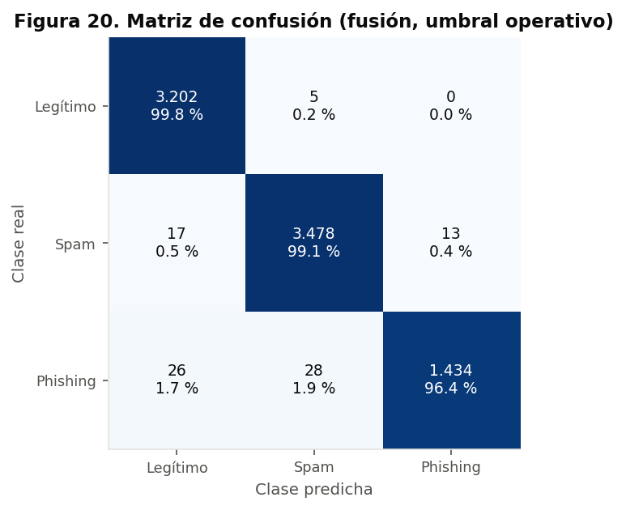
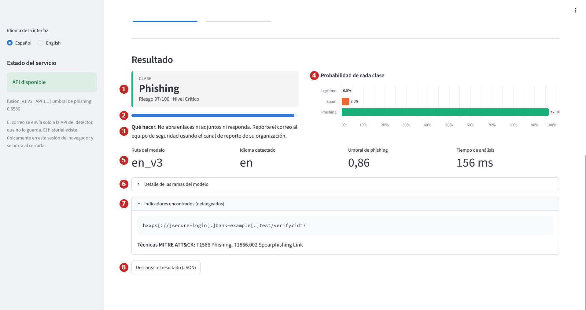
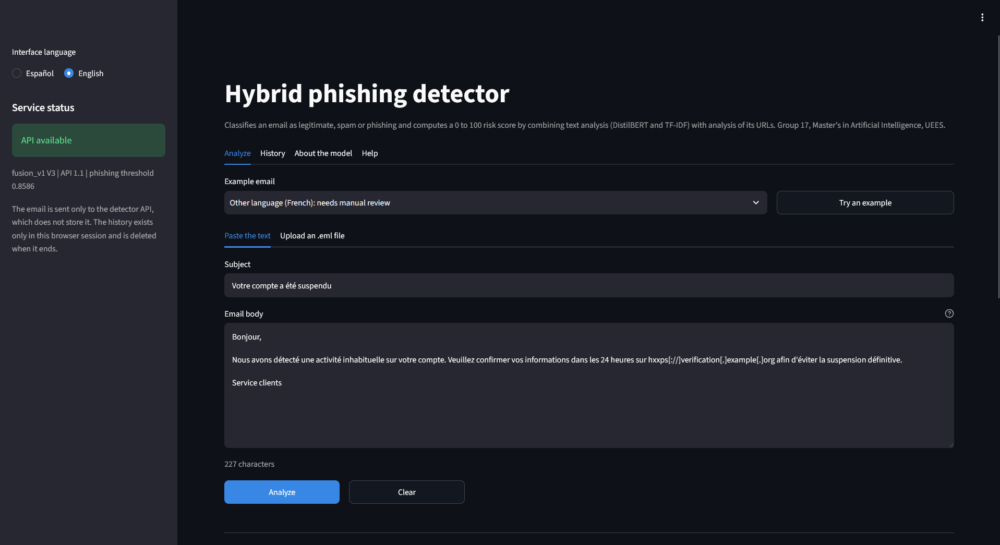

# Detector híbrido de phishing: texto y URL

[](https://www.python.org/)
[](LICENSE)
[](https://streamlit.io/)
[](https://github.com/dfsd0001/phishing-hibrido-g17/actions/workflows/pruebas.yml)

Sistema que clasifica un correo electrónico como **legítimo, spam o phishing** y le asigna un
**riesgo calibrado de 0 a 100**, combinando el análisis del texto (DistilBERT y TF-IDF) con el análisis
léxico de sus URL (XGBoost), sin visitar nunca los enlaces. Incluye una API, una interfaz web y la
integración con herramientas de un centro de operaciones de seguridad (n8n, DFIR-IRIS y Wazuh).

Proyecto Integrador de la Maestría en Inteligencia Artificial (MIAR0545), Universidad de
Especialidades Espíritu Santo (UEES). Grupo 17, octubre de 2026.

**Demostración en línea:** https://phishing-hibrido-g17.streamlit.app

## Tabla de contenidos

1. [Descripción del problema](#descripción-del-problema)
2. [Datos](#datos)
3. [Metodología](#metodología)
4. [Resultados](#resultados)
5. [Instalación y uso](#instalación-y-uso)
6. [Interfaz de usuario](#interfaz-de-usuario)
7. [Estructura del proyecto](#estructura-del-proyecto)
8. [Consideraciones éticas](#consideraciones-éticas)
9. [Autores y contribuciones](#autores-y-contribuciones)
10. [Licencia](#licencia)
11. [Agradecimientos y referencias](#agradecimientos-y-referencias)
12. [Videos](#videos)

## Descripción del problema

**Qué resuelve.** En un centro de operaciones de seguridad (SOC), los correos que los empleados
reportan como sospechosos se revisan uno por uno. Ese triaje manual consume el tiempo de los
analistas de nivel 1, genera fatiga de alertas y depende de listas negras y reglas que no reconocen
dominios nuevos ni textos persuasivos nuevos. El sistema clasifica cada correo, estima la probabilidad
de que sea phishing, extrae sus indicadores ya defangeados y deja una alerta prellenada en el gestor de
casos.

**Por qué importa.** El phishing es la técnica de acceso inicial T1566 de MITRE ATT&CK, y los correos
redactados con modelos de lenguaje aumentan su efectividad (Heiding et al., 2024). Priorizar bien la
cola reduce el tiempo en que una campaña puede robar credenciales.

**Usuarios.** Analistas SOC de nivel 1, en primer lugar; analistas de nivel 2, equipos de respuesta a
incidentes y responsables de seguridad, en segundo. La interfaz también la puede usar cualquier persona
que quiera revisar un correo sospechoso.

Más detalle en [docs/planificacion.md](docs/planificacion.md).

## Datos

Corpus públicos de terceros, que **no se redistribuyen** en este repositorio. Se versionan sus
manifiestos con la huella SHA-256 de cada archivo.

| Fuente | Clases que aporta | Licencia | Correos en el dataset final |
|---|---|---|---:|
| CEAS 2008 y SpamAssassin (Phishing Email Dataset de Kaggle, derivado del conjunto curado de Champa en Zenodo) | Legítimo y spam | CC BY 4.0 (Zenodo) | 44.765 |
| Nigerian Fraud (mismo origen) | Phishing | CC BY 4.0 (Zenodo) | 3.290 |
| Nazario Phishing Corpus, 2015 a 2025 | Phishing | CC BY 4.0 | 2.927 |
| phishing_pot | Phishing | CC BY-NC 4.0 | 3.702 |
| SpaPhish y SpearPhishMX (ruta en español) | Phishing y legítimo | CC BY 4.0 | 4.268 |

* **Tamaño.** 94.566 correos leídos; **54.684** en el dataset final en inglés (legítimo 39,1 %, spam
  42,8 %, phishing 18,1 %), divididos en 70 % entrenamiento, 15 % validación y 15 % prueba,
  estratificados por clase y corpus.
* **Variables.** Asunto y cuerpo (texto o HTML); de ellos se derivan el texto de modelo, con marcadores
  en lugar de URL, IP, correos y años, y 22 variables léxicas por cada URL.
* **Validación externa.** 2.000 correos corporativos de Enron, 641 correos nativos en español y cuatro
  correos reales de phishing de malware-traffic-analysis.net.

Fuentes, licencias, versiones y cómo obtener los datos: [data/README.md](data/README.md). Análisis
exploratorio: [docs/analisis_datos.md](docs/analisis_datos.md).

## Metodología

**Modelo: fusión tardía de tres ramas.**

| Rama | Modelo | Por qué |
|---|---|---|
| Texto, línea base | TF-IDF de palabras y caracteres con regresión logística | Rápida, interpretable y difícil de superar |
| Texto, principal | DistilBERT ajustado (66,9 millones de parámetros) | Captura contexto como la urgencia o la suplantación; infiere en CPU en menos de un segundo |
| URL | XGBoost sobre 22 variables léxicas y el dominio de primer nivel | Señal independiente del texto; se calcula sin resolver ni visitar la URL |
| Fusión | Regresión logística con calibración isotónica | Probabilidad confiable para fijar umbrales con un costo de error conocido |

Los correos en español usan un DistilBERT multilingüe propio; cualquier otro idioma se marca para
revisión manual.

**Preprocesamiento.** Exclusión de corpus con URL destruidas o duplicados, filtro de idioma,
deduplicación por huella antes de particionar, defanging de todos los indicadores y sustitución de URL,
IP, correos y años por marcadores para que el modelo no memorice la fuente.

**Selección y optimización.**

* El modelo final (V3) se eligió por su recall de phishing en pliegues en los que un corpus o un periodo
  completo queda fuera del entrenamiento, no por la partición aleatoria.
* Búsqueda bayesiana con Optuna, análisis de sensibilidad con fANOVA, dependencia parcial e
  interacciones, y comparación antes y después con bootstrap y Wilcoxon (Workshop 2 de la Semana 5).
* Umbral operativo elegido con correo corporativo real, en una mitad de los datos y reportado en la otra.
* Escenarios de estrés: ruido, ofuscación, texto truncado, rama caída, desbalance y cambio de
  distribución (Workshop 1 de la Semana 5).

**Métricas.** F1 macro de tres clases; recall, precisión y tasa de falsos positivos (FPR) de phishing;
AUC; calibración (Brier y ECE); latencia; y, en la integración, alertas creadas y tiempo de triaje.

Detalle en [docs/arquitectura.md](docs/arquitectura.md) y [docs/optimizacion.md](docs/optimizacion.md).

## Resultados

Partición de prueba en inglés (8.203 correos que no intervinieron en ninguna decisión), umbral
operativo, intervalos de confianza al 95 % por bootstrap.

| Modelo | F1 macro | Recall de phishing | Precisión de phishing | FPR de phishing |
|---|---|---|---|---|
| Piso de referencia (aleatorio estratificado) | 0,334 | 19,6 % | 19,3 % | 18,21 % |
| Línea base TF-IDF | 0,987 | 98,3 % | 97,5 % | 0,55 % |
| DistilBERT | 0,990 | 98,7 % | 97,9 % | 0,46 % |
| **Fusión V3, umbral operativo** | **0,987** [0,984; 0,989] | **96,4 %** [95,4; 97,3] | **99,1 %** [98,6; 99,5] | **0,19 %** [0,10; 0,31] |

**Lectura honesta.** En la partición aleatoria los tres modelos superan 0,98 de F1 y la prueba de
McNemar no encuentra diferencias significativas. El aporte de la fusión está en otros dos frentes:

* **Fuentes nunca vistas.** Con phishing_pot fuera del entrenamiento, la fusión detecta el 83,5 % de ese
  phishing, frente al 68,5 % de la línea base y el 73,6 % de DistilBERT. En promedio sobre cuatro
  pliegues fuera de distribución: 93,4 % frente a 87,3 %.
* **Un puntaje calibrado con umbral ajustable** (Brier 0,0111, 27 % menor que el de DistilBERT), que
  permitió bajar los falsos positivos en correo corporativo de 12,5 % a 1,3 %.

**Metas SMART**

| Meta | Resultado | Cumple |
|---|---|---|
| F1 macro de 90 % o más | 98,7 % | Sí |
| Recall de phishing de 95 % o más | 96,4 % | Sí |
| FPR de 2 % o menos | 1,3 % en correo corporativo en inglés; 3,5 % en español nativo | Sí en inglés; no en español |
| Latencia menor que 1 s | Percentil 95 de 275 ms de punta a punta | Sí |
| Defanging del 100 % | 0 indicadores vivos en datos y salidas | Sí |
| Alertas integradas en el SOC, más de 90 % | 100 % (83 de 83) | Sí |
| Reducción del tiempo de triaje de 40 % o más | 32,4 %, IC 95 % de -25,2 a 68,0 (estimación con 20 correos) | No; no concluyente |



Resultados completos: [results/reports/resumen_resultados.md](results/reports/resumen_resultados.md).

## Instalación y uso

### Requisitos

* Python 3.13 (probado; el código admite 3.10 o superior).
* Para la demostración completa: Docker con Docker Compose v2 y al menos 12 GB de memoria asignados.
* Un token de **solo lectura** de Hugging Face con acceso al repositorio privado de modelos. Los pesos
  no son públicos; el docente recibe el token por un canal privado (ver
  [models/README.md](models/README.md)).

### Instalación del entorno de desarrollo

```bash
git clone https://github.com/dfsd0001/phishing-hibrido-g17.git
cd phishing-hibrido-g17
python -m venv .venv
source .venv/bin/activate        # en Windows: .venv\Scripts\activate
pip install -r requirements.txt
```

### Pruebas

```bash
pytest          # pruebas unitarias, de la API, de la interfaz, del flujo de n8n y del repositorio
ruff check .    # estilo (PEP 8) y calidad del código
```

Las pruebas no necesitan el modelo ni los datos: usan componentes simulados.

### Demostración con Docker (API e interfaz)

```bash
cd deploy
cp .env.example .env             # completar API_KEY y HF_TOKEN
docker compose up -d --build api ui
```

La primera vez la API descarga el modelo (de 2 a 5 minutos). Luego abra **http://localhost:8501**. El
entorno completo, con n8n, DFIR-IRIS y Wazuh, se describe en [deploy/README.md](deploy/README.md).

### Uso de la API

```bash
curl -s -X POST http://127.0.0.1:8000/v1/analizar \
  -H "X-API-Key: $API_KEY" -H "Content-Type: application/json" \
  -d '{"asunto": "Account suspended", "cuerpo": "Verify your password at https://secure-login.example.com/verify within 24 hours."}'
```

La respuesta sigue el contrato JSON v1.2 (`contracts/contrato_v1.schema.json`): clase, riesgo, nivel,
probabilidades, detalle por rama, indicadores defangeados y técnicas de MITRE ATT&CK. Un archivo .eml se
envía codificado en base64 en el campo `eml_base64`.

### Uso desde Python

```python
from src.model import Detector

detector = Detector.desde_directorio(".", umbral_en=0.8586)   # con los artefactos en models/
resultado = detector.analizar(asunto="Account suspended", cuerpo="Verify your password at ...")
print(resultado["clasificacion"])
```

### Reproducir el análisis

Los notebooks `notebooks/01_exploracion` a `05_evaluacion` reproducen el análisis exploratorio, el
preprocesamiento, el modelado, la optimización y la evaluación. Se ejecutan en Google Colab; la
preparación de datos y los tiempos de cada uno están en [notebooks/README.md](notebooks/README.md).

## Interfaz de usuario

Aplicación web en Streamlit que consulta la API. Permite:

* pegar el asunto y el cuerpo o subir un archivo .eml, con validación de la entrada;
* probar cinco correos de ejemplo (phishing, legítimo y spam en inglés, phishing en español y un correo
  en francés);
* ver la clase, el riesgo, la probabilidad de cada clase, el detalle por rama, los indicadores
  defangeados y una recomendación de qué hacer;
* recibir avisos cuando el texto es corto o el idioma no está soportado;
* revisar el historial de la sesión con un gráfico comparativo y descargarlo en CSV, o el resultado en
  JSON;
* consultar las métricas y las limitaciones del modelo en *Acerca del modelo* y la guía en *Ayuda*;
* usarla en español o inglés, con tema claro u oscuro.





**Demostración en línea: [phishing-hibrido-g17.streamlit.app](https://phishing-hibrido-g17.streamlit.app)**. Es la misma interfaz con el modelo cargado dentro de
la aplicación, en Streamlit Community Cloud. Úsela con los ejemplos o con correos de prueba: los
servidores están en Estados Unidos. La primera visita después de un periodo sin uso tarda unos minutos
mientras se carga el modelo. Cómo se publica y con qué límites: [nube/README.md](nube/README.md). La
verificación del 22/10/2026 (16 análisis entre 53 y 354 ms, mismos resultados que en el despliegue
local) está en `results/metrics/demo_nube_v1.json`.

La interfaz también se ejecuta en local (`http://localhost:8501`, ver la sección anterior), conectada a
la API y al SOC. Guía completa con capturas anotadas: [docs/manual_usuario.md](docs/manual_usuario.md).

## Estructura del proyecto

```
phishing-hibrido-g17/
├── README.md, LICENSE, requirements.txt, config.yaml, pyproject.toml
├── docs/            Planificación, análisis de datos, arquitectura, optimización, ética, manual y bitácora
├── data/            Manifiestos con huellas SHA-256 y guía para obtener los datos (los correos no se versionan)
├── notebooks/       01_exploracion a 05_evaluacion; experimentos/ conserva el registro completo del desarrollo
├── src/             Procesamiento, indicadores, variables de URL, modelo, entrenamiento, evaluación y gráficos
├── models/          Ficha del modelo y manifiesto; los pesos están en Hugging Face Hub (privado)
├── app/             Interfaz web en Streamlit, con su Dockerfile y dependencias
├── api/             Servicio de inferencia en FastAPI
├── nube/            Punto de entrada y dependencias de la demostración en Streamlit Community Cloud
├── contracts/       Contrato JSON v1.2 (JSON Schema) y ejemplos de referencia
├── deploy/          docker-compose, flujo de n8n, reglas de Wazuh y scripts de los KPI de integración
├── tests/           Pruebas automáticas
└── results/         Figuras, métricas y reportes generados
```

| Módulo de `src/` | Función |
|---|---|
| `ioc_utils.py` | Extracción, defanging y refang en memoria de URL e IPv4; verificador de indicadores vivos |
| `data_processing.py` | Lectura de correos, texto de modelo, exclusiones, particiones y pliegues |
| `url_features.py` | 22 variables léxicas de una URL |
| `model.py` | Detector completo: rutas por idioma, fusión, riesgo y contrato de salida |
| `train.py` | Entrenamiento de la línea base, la rama URL y el meta-clasificador calibrado |
| `evaluate.py` | Métricas, intervalos de confianza y pruebas estadísticas |
| `escenarios.py` | Perturbaciones de los escenarios de estrés |
| `diagnostico.py` | Curvas de aprendizaje y diagnóstico de sobreajuste |
| `visualizacion.py`, `utils.py` | Estilo de las figuras, configuración y rutas |

## Consideraciones éticas

* **Sesgos.** No usa datos demográficos, pero sí tiene sesgos de fuente, de época, de estilo y de
  idioma. La brecha más importante es la del español: 3,5 % de falsos positivos frente a 1,3 % en
  inglés. El análisis por subgrupos con Fairlearn (corpus, longitud, URL y antigüedad) queda dentro de
  los límites fijados.
* **Privacidad.** En el despliegue local la inferencia corre en la infraestructura propia; la
  respuesta no incluye el cuerpo del correo; la API no guarda los correos; los datos de entrenamiento
  no se redistribuyen. La demostración pública se usa solo con ejemplos o correos de prueba.
* **Seguridad.** Ninguna URL se resuelve ni se visita; todos los indicadores salen defangeados y la API
  bloquea cualquier respuesta con un indicador vivo.
* **Supervisión humana.** El sistema sugiere y el analista decide: ningún correo se cierra, borra ni
  bloquea de forma automática.

**Limitaciones conocidas.** El recall baja ante campañas de un corpus nunca visto (83,5 %), en textos
de menos de 300 caracteres (93,2 %) y, sobre todo, ante phishing dirigido en español de un estilo no
visto (7,6 %). No analiza adjuntos, imágenes ni encabezados de autenticación. Solo admite inglés y
español.

**Usos no permitidos.** Escanear buzones sin base legal, evaluar o sancionar empleados, automatizar
bloqueos sin revisión humana, exponer la API del SOC a internet o usar la demostración para afinar
campañas de phishing.

Análisis completo de los ocho puntos: [docs/consideraciones_eticas.md](docs/consideraciones_eticas.md).

## Autores y contribuciones

| Integrante | Rol | Contribuciones principales |
|---|---|---|
| Dennys Francisco Salazar Domínguez | Líder técnico | Arquitectura, preparación de datos, modelado, integración con el SOC y validación de dominio desde su experiencia como jefe de SOC |
| Lenin Bolívar González Rivadeneira | Dueño del producto | Alcance y metas, evaluación y análisis de equidad, revisión de la documentación y validación de la interfaz |

Ambos integrantes participaron en la definición del problema, el análisis de resultados y la revisión
final del repositorio.

## Licencia

El código se publica con licencia [MIT](LICENSE). Los datos de terceros conservan sus licencias
(ver [data/README.md](data/README.md)); en particular, phishing_pot es CC BY-NC 4.0 y no admite uso
comercial. Los pesos del modelo no se distribuyen con este repositorio.

## Agradecimientos y referencias

A la docente del Proyecto Integrador, Gladys María Villegas Rugel, por la guía durante el semestre, y a
los autores de los corpus públicos que hicieron posible el trabajo.

* Bustio-Martínez, L. et al. (2026). Spanish phishing and legitimate email dataset with technical and
  psychological annotations. *Data in Brief, 67*, 112890. https://doi.org/10.1016/j.dib.2026.112890
* Champa, A. I. (2023). *Phishing Email Curated Datasets*. Zenodo. https://doi.org/10.5281/zenodo.8339691
* Chen, T. y Guestrin, C. (2016). XGBoost: A scalable tree boosting system. arXiv:1603.02754.
* Diaz, J. M., Martínez Cruz, A. y Bustio Martinez, L. (2026). *SpearPhishMX* (versión 2). Mendeley Data.
  https://doi.org/10.17632/h4bxjk84jb.2
* Heiding, F., Schneier, B., Vishwanath, A., Bernstein, J. y Park, P. S. (2024). Devising and detecting
  phishing emails using large language models. *IEEE Access, 12*, 42131-42146.
  https://doi.org/10.1109/ACCESS.2024.3375882
* Akiba, T., Sano, S., Yanase, T., Ohta, T. y Koyama, M. (2019). Optuna: A next-generation
  hyperparameter optimization framework. arXiv:1907.10902.
* Mitchell, M. et al. (2019). Model cards for model reporting. arXiv:1810.03993.
* Sanh, V., Debut, L., Chaumond, J. y Wolf, T. (2019). DistilBERT, a distilled version of BERT: smaller,
  faster, cheaper and lighter. arXiv:1910.01108.
* MITRE. T1566: Phishing. https://attack.mitre.org/techniques/T1566/

Las referencias de cada tema están al final de los documentos de [docs/](docs/).

## Videos

* **Video pitch (5 minutos):** enlace pendiente de publicación.
* **Video de respuestas a las preguntas:** enlace pendiente de publicación.
