# Análisis de los datos

Este documento describe los datos con los que se entrenó y evaluó el detector, los hallazgos del
análisis exploratorio y las decisiones de preparación que se tomaron a partir de ellos. El código y
las salidas completas están en `notebooks/01_exploracion.ipynb` y
`notebooks/02_preprocesamiento.ipynb`; las cifras, en
[`results/metrics/eda_resumen.json`](../results/metrics/eda_resumen.json) y
[`results/metrics/preprocesamiento_resumen.json`](../results/metrics/preprocesamiento_resumen.json).
Las fuentes, licencias y huellas SHA-256 de los archivos originales están en
[`data/README.md`](../data/README.md).

Todo el texto se maneja defangeado (por ejemplo `hxxps[://]ejemplo[.]com`). Ninguna URL de los
corpus se resolvió ni se visitó.

## 1. Descripción de los datos

### 1.1 Fuentes

El problema necesita tres clases, pero ningún corpus público trae las tres. Se combinaron corpus
binarios y se armonizaron sus etiquetas (diccionario de etiquetas v1).

| Corpus | Formato original | Clases que aporta | Correos en la tabla intermedia | Uso final |
|---|---|---|---:|---|
| CEAS_08 (Kaggle) | CSV con texto extraído | legítimo y spam | 39.154 | Entrenamiento y evaluación |
| SpamAssassin (Kaggle) | CSV con texto extraído | legítimo y spam | 5.809 | Entrenamiento y evaluación |
| Nigerian_Fraud (Kaggle) | CSV con texto extraído | phishing (fraude de pago anticipado) | 3.332 | Entrenamiento y evaluación |
| Nazario anual 2015-2025 | 11 archivos mbox crudos | phishing | 3.466 | Entrenamiento y evaluación |
| phishing_pot | 8.614 archivos .eml crudos | phishing | 8.614 | Entrenamiento y evaluación (solo inglés) |
| Enron (Kaggle) | CSV con texto tokenizado | legítimo y spam | 29.767 | Excluido |
| Ling (Kaggle) | CSV con texto tokenizado | legítimo y spam | 2.859 | Excluido |
| Nazario (Kaggle) | CSV con texto extraído | phishing | 1.565 | Excluido (duplica a Nazario anual) |
| **Total** | | | **94.566** | |

Fuentes auxiliares, que no entran al entrenamiento del modelo de texto:

* **SpaPhish y SpearPhishMX**: correos nativos en español (phishing y legítimo) para la ruta española.
* **Espejo traducido**: el corpus inglés traducido al español con OPUS-MT, usado solo para entrenar la
  ruta española (aporta el spam, que no existe en los corpus nativos).
* **Enron-Spam** (2.000 correos legítimos): validación de falsos positivos en correo corporativo.
* **PhiUSIIL** (235.795 URL) y una copia de **PhishTank** (32.239 URL): evidencia sobre la rama URL.

### 1.2 Variables

| Variable | Tipo | Descripción |
|---|---|---|
| `fuente`, `grupo` | categórica | Archivo y corpus de origen |
| `etiqueta_original` | entera | Etiqueta publicada por la fuente (0 o 1) |
| `clase` | categórica | Clase armonizada: legítimo, spam o phishing |
| `asunto`, `texto_defang` | texto | Asunto y cuerpo, con URL e IPv4 defangeadas |
| `texto_modelo` | texto | Entrada de los modelos: sin HTML y con marcadores en lugar de URL, IP, correo, año y dominio propio |
| `anio` | entera | Año del encabezado `Date`, si existe |
| `idioma` | categórica | Idioma detectado con `langdetect` |
| `hash` | texto | SHA-1 del texto plano normalizado, para deduplicar |
| `n_urls`, `sin_url` | numérica, booleana | URL válidas extraídas del correo |
| `es_html` | booleana | El cuerpo contiene HTML |
| `len_plano` | entera | Longitud del texto plano en caracteres |
| `split`, `pliegue_*` | categórica | Partición principal y pliegues fuera de distribución |

## 2. Estadísticas descriptivas

Tabla intermedia (94.566 correos, antes de cualquier exclusión):

| Clase | Correos | Longitud mediana (caracteres) | Percentil 99 | URL por correo (mediana) | URL por correo (percentil 99) |
|---|---:|---:|---:|---:|---:|
| Legítimo | 39.595 | 1.090 | 17.781 | 0 | 19 |
| Spam | 37.994 | 425 | 8.368 | 0 | 24 |
| Phishing | 16.977 | 966 | 429.081 | 2 | 34 |

**Datos faltantes.** La fecha falta en el 100 % de Enron y Ling y en el 14,9 % de Nigerian_Fraud; en
el resto de corpus, en menos del 2 %. El idioma se midió en el 100 % de los correos crudos
(phishing_pot y Nazario anual) y en una muestra de 1.500 correos por corpus de Kaggle, donde entre el
95,8 % y el 99,6 % estaba en inglés. Hay 39 textos casi vacíos (menos de 20 caracteres). No se imputa
ningún valor: la fecha y el idioma solo se usan para describir, filtrar y construir el pliegue
temporal, y los textos casi vacíos se excluyen.

## 3. Hallazgos del análisis exploratorio

### 3.1 Composición: la clase está ligada al corpus

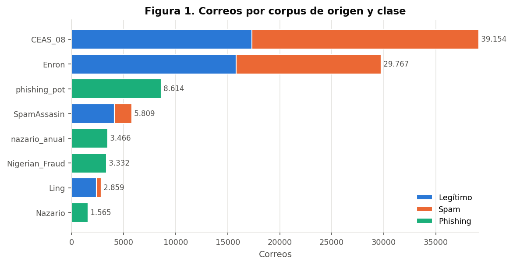

*Figura 1. Número de correos por corpus y clase en la tabla intermedia.*

Cada corpus aporta una sola clase o el par legítimo y spam, y el phishing proviene siempre de corpus
distintos a los de las otras dos clases. Un modelo podría aprender a reconocer la fuente en lugar del
phishing. La prueba de artefacto lo confirma: un clasificador TF-IDF predice el corpus de origen con
F1 macro de 0,81, y con solo metadatos (longitud, URL, HTML, longitud del asunto) predice la clase con
F1 de 0,63. Por eso se exigió que cada clase tuviera al menos dos corpus y se evaluó con pliegues en
los que un corpus completo queda fuera del entrenamiento.

### 3.2 Longitud del texto y valores atípicos

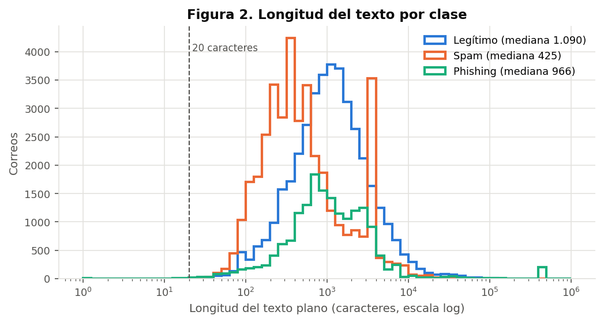

*Figura 2. Distribución de la longitud del texto plano por clase, en escala logarítmica.*

Las longitudes cubren seis órdenes de magnitud. Por encima del percentil 99 (15.489 caracteres) hay
945 correos, de los cuales el 48,9 % es legítimo, el 38,9 % phishing y el 12,2 % spam. Se conservan
porque son correos reales; en lugar de eliminarlos, la entrada de los modelos se trunca de forma
declarada (5.000 caracteres para TF-IDF y 256 tokens para DistilBERT).

### 3.3 Presencia de URL

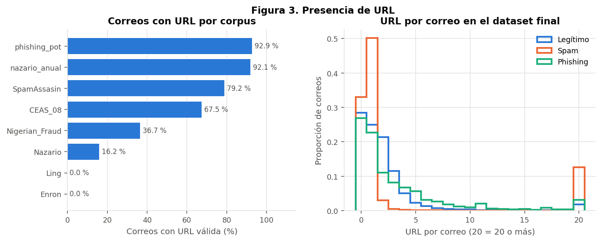

*Figura 3. Porcentaje de correos con al menos una URL válida por corpus, y número de URL por correo
según la clase.*

Enron y Ling contienen la cadena `http`, pero ninguna URL válida: su texto viene tokenizado y las URL
quedaron rotas. En el dataset final tienen URL el 71,5 % de los legítimos, el 73,1 % del phishing y el
67,0 % del spam, de modo que la rama URL es aplicable a la mayoría de los correos y la presencia de
URL no separa las clases por sí sola. Los correos sin URL reciben un valor neutro en la rama URL y el
indicador `sin_url`.

### 3.4 Cobertura temporal

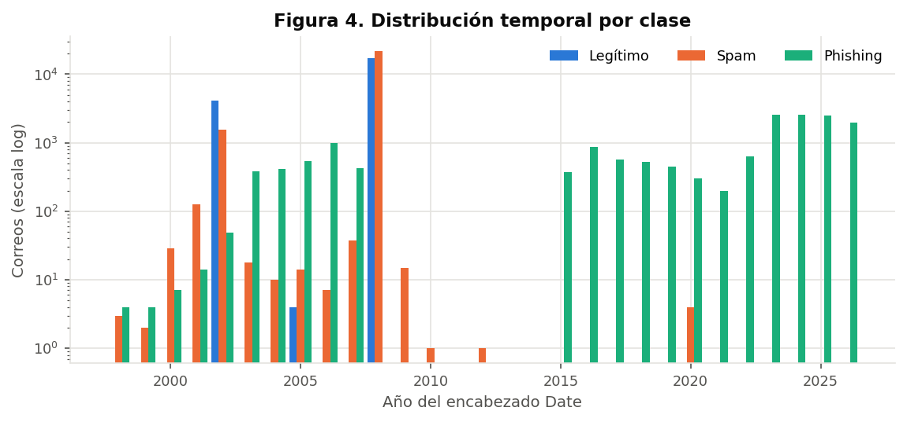

*Figura 4. Año del encabezado `Date` por clase.*

El legítimo cubre 2002 a 2008 (mediana 2008) y el spam 1998 a 2020 (mediana 2008), mientras que el
phishing llega a 2026 con mediana 2023. El año, o cualquier expresión ligada a él, es un atajo que el
modelo podría aprender. Los años de 1980 a 2029 se reemplazan por el marcador `__anio__` y se reservó
un pliegue temporal (phishing desde 2025 fuera del entrenamiento).

### 3.5 Idioma

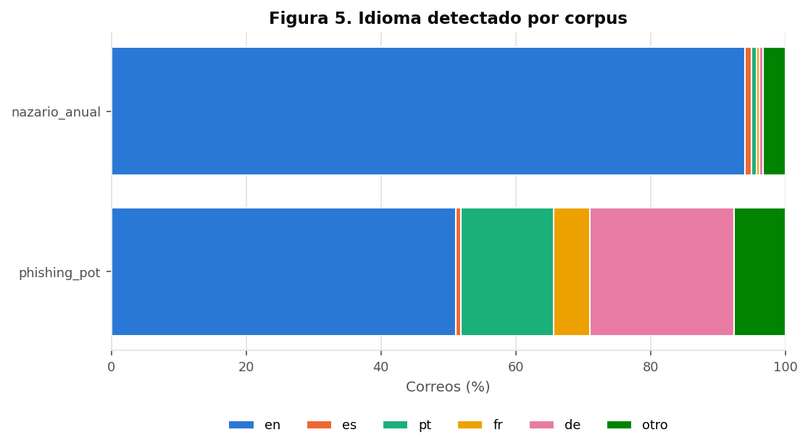

*Figura 5. Idiomas detectados en los corpus crudos.*

Solo el 51,1 % de phishing_pot está en inglés (le siguen alemán con 21,3 % y portugués con 13,8 %);
Nazario anual está en inglés en un 94,0 %. El modelo inglés se entrena solo con inglés y el español
tiene una ruta propia.

### 3.6 Duplicados y conflictos de etiqueta

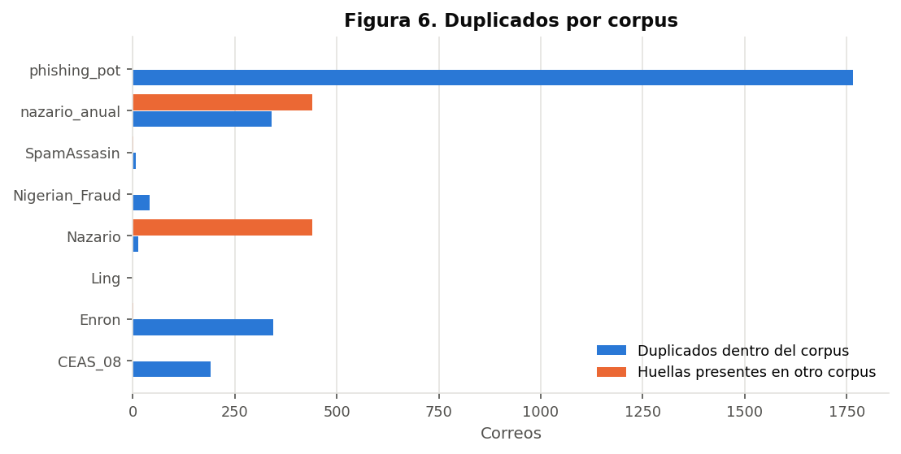

*Figura 6. Correos duplicados dentro de cada corpus y huellas repetidas entre corpus.*

Hay 2.702 duplicados dentro de los corpus y 441 huellas repetidas entre corpus, sin ningún conflicto
de clase. Las huellas compartidas entre Nazario en CSV y Nazario anual confirman que son el mismo
material; se conservó la versión cruda, que mantiene los enlaces (92,1 % de correos con URL frente a
16,2 % en el CSV).

### 3.7 Correlaciones

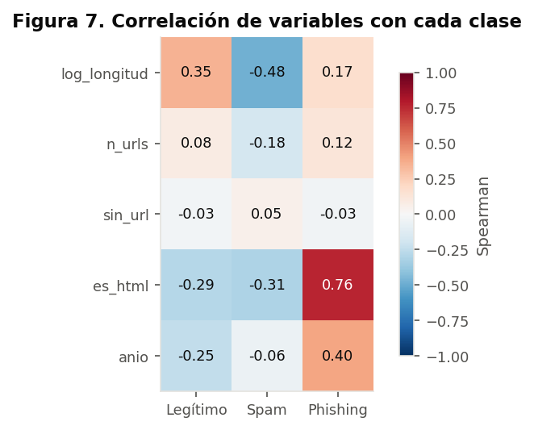

*Figura 7. Correlación de Spearman entre las variables numéricas y el indicador de cada clase, en el
dataset final.*

| Variable | Legítimo | Spam | Phishing |
|---|---:|---:|---:|
| Logaritmo de la longitud | 0,349 | -0,477 | 0,170 |
| Número de URL | 0,082 | -0,178 | 0,124 |
| Sin URL | -0,028 | 0,054 | -0,033 |
| Es HTML | -0,286 | -0,309 | 0,759 |
| Año | -0,245 | -0,061 | 0,396 |

La variable más asociada al phishing es el formato HTML (0,76). No es una propiedad del phishing sino
del formato de origen: el atributo `href` aparece en cerca del 90 % de los correos crudos de
phishing_pot y Nazario anual y en menos del 1 % de los CSV de Kaggle. Le siguen el año (0,40) y, para
el spam, la longitud corta (-0,48). Ninguna de estas variables entra al modelo de texto: el texto de
modelo elimina el HTML y enmascara los años. La presencia y el número de URL, con correlaciones bajas,
llegan al meta-clasificador a través de la rama URL.

### 3.8 Términos asociados a cada clase

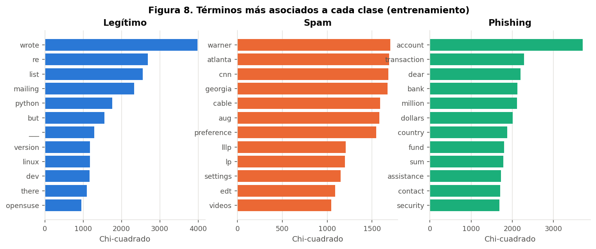

*Figura 8. Términos con mayor estadístico chi-cuadrado por clase, calculados sobre entrenamiento.*

* **Legítimo:** vocabulario de listas de correo técnicas (*wrote*, *list*, *mailing*, *python*,
  *linux*).
* **Spam:** pies de boletín repetidos (*cnn*, *atlanta*, *warner*, *cable*, *preference*), señal de
  campañas masivas que reutilizan la misma plantilla.
* **Phishing:** fraude de pago anticipado (*transaction*, *million*, *dollars*, *fund*) y suplantación
  de cuentas (*account*, *bank*, *security*).

Los términos describen el estilo de cada corpus más que una regla general. Se controla con una sonda
de fuga (términos que nombran la fuente) y con los pliegues fuera de distribución.

### 3.9 Datos en español

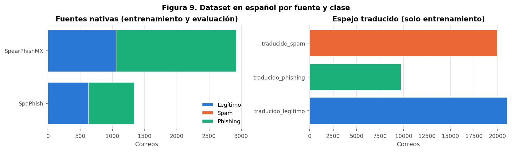

*Figura 9. Composición del dataset en español.*

| Grupo | Legítimo | Spam | Phishing | Total |
|---|---:|---:|---:|---:|
| SpaPhish (nativo) | 632 | 0 | 711 | 1.343 |
| SpearPhishMX (nativo) | 1.059 | 0 | 1.866 | 2.925 |
| Espejo traducido (solo entrenamiento) | 21.083 | 20.026 | 9.753 | 50.862 |

No existe spam nativo en español, de modo que la ruta española es en la práctica binaria (phishing
frente a no phishing). Los correos traducidos solo se usan para entrenar. Los nativos se dividen en
entrenamiento, validación y prueba (70/15/15), y su prueba nunca interviene en el entrenamiento: es
la única forma de medir el desempeño con español real (decisiones D18 y D20).

## 4. Preparación de los datos

### 4.1 Exclusiones

Se aplican en orden y cada correo recibe el primer motivo que cumple:

| Orden | Motivo | Regla | Correos | Justificación |
|---|---|---|---:|---|
| 1 | Corpus excluido | Nazario en CSV, Enron y Ling | 34.191 | URL destruidas o perdidas, sin fecha, formato que delata la fuente; Nazario en CSV duplica a Nazario anual |
| 2 | Casi vacío | Texto plano de menos de 20 caracteres | 30 | Sin contenido que clasificar |
| 3 | Idioma | Correos no ingleses de phishing_pot y Nazario anual | 4.396 | El modelo inglés se entrena solo con inglés |
| 4 | Duplicado | Huella ya conservada | 1.265 | Un mismo correo no puede estar en entrenamiento y en prueba |

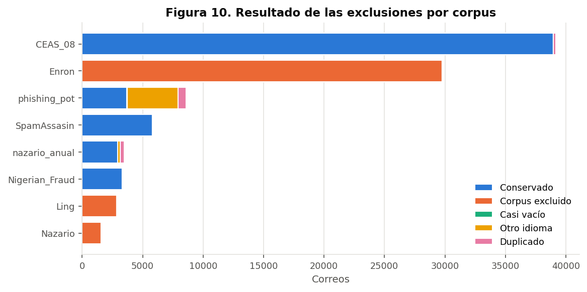

*Figura 10. Correos conservados y excluidos por corpus.*

Resultado: **54.684 correos**, con legítimo de CEAS_08 y SpamAssassin (21.379), spam de los mismos dos
corpus (23.386) y phishing de Nigerian_Fraud, Nazario anual y phishing_pot (9.919). Cada clase tiene
al menos dos corpus de origen.

### 4.2 Texto de entrada de los modelos

1. `texto_de_email` extrae asunto y cuerpo de los archivos .eml y mbox, conservando los enlaces de los
   atributos `href`.
2. `ioc_utils.defang_texto` defangea cada URL e IPv4 antes de guardar cualquier tabla.
3. `texto_para_modelo` elimina el HTML y sustituye URL, IP, direcciones de correo, años y el dominio
   del buzón del autor de Nazario por marcadores (`__url__`, `__ip__`, `__email__`, `__anio__`,
   `__dominio_propio__`). Así el modelo de texto no memoriza dominios, buzones ni fechas de cada
   corpus.

Porcentaje de correos con cada marcador en el dataset final: URL 61,3 %, correo electrónico 32,9 %,
año 44,9 %, IP 2,3 % y dominio propio 1,2 %. Ningún texto de modelo contiene un indicador vivo.

**Sonda de fuga.** Solo dos términos aparecen en más del 5 % de un corpus: *nigerian* en
Nigerian_Fraud (7,1 %) y *spamassassin* en SpamAssassin (9,1 %). El primero es parte del relato del
fraude y el segundo identifica un corpus que aporta dos clases, así que por sí solo no decide entre
ellas; ambos se conservaron y su efecto se mide con los pliegues correspondientes. El dominio del
buzón de Nazario sí se enmascaró, porque solo identificaba la fuente.

### 4.3 Particiones y pliegues fuera de distribución

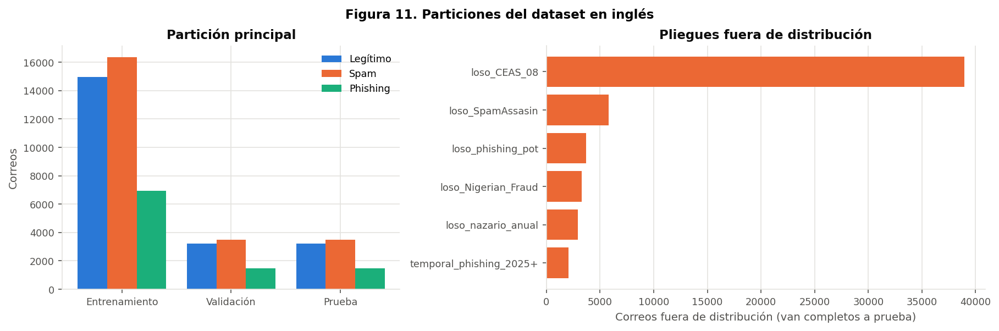

*Figura 11. Tamaño de las particiones por clase y de cada pliegue fuera de distribución.*

| Partición | Legítimo | Spam | Phishing | Phishing (%) |
|---|---:|---:|---:|---:|
| Entrenamiento (70 %) | 14.965 | 16.370 | 6.943 | 18,1 |
| Validación (15 %) | 3.207 | 3.508 | 1.488 | 18,1 |
| Prueba (15 %) | 3.207 | 3.508 | 1.488 | 18,1 |

La partición es estratificada por clase y corpus. Los pliegues fuera de distribución envían a prueba
un corpus completo (por ejemplo `loso_phishing_pot`, con 3.702 correos fuera) o el phishing desde
2025 (`temporal_phishing_2025+`, 2.040 correos fuera) y conservan la partición del resto. Miden si el
modelo reconoce phishing de una fuente o un periodo que nunca vio.

**Reproducibilidad.** El preprocesamiento del repositorio reconstruye el dataset con el que se
entrenaron los modelos publicados con un 100 % de coincidencia en correos, clase, partición, texto de
modelo y pliegues.

### 4.4 Desbalance de clases

El phishing representa el 18,1 % de cada partición. No se sobremuestrea ni se generan correos
sintéticos en inglés. El desbalance se maneja con:

* pesos de clase inversos a la frecuencia de entrenamiento (legítimo 0,853, spam 0,779, phishing
  1,838) en la regresión logística y en la pérdida de DistilBERT;
* un umbral de decisión fijado por la tasa de falsos positivos y no por exactitud;
* métricas que no se dejan engañar por la clase mayoritaria (F1 macro, recall, precisión y FPR de
  phishing). El escenario de desbalance del notebook 05 muestra por qué: con 1 % de phishing la
  exactitud sube a 99,5 % mientras la precisión baja a 83,7 %.

## 5. Calidad de las etiquetas

Una revisión manual de 50 correos de phishing_pot encontró que el 64 % (IC 95 % 50,1 a 75,9) era phishing o estafa según el diccionario de etiquetas;
el 34 % era spam y el 2 %, legítimo. Proyectado a la fuente, entre 892 y 1.847 de sus 3.702 correos
podrían tener una etiqueta incorrecta. No se corrigió por falta de tiempo para una revisión completa;
se declara como limitación y explica parte de los errores spam a phishing del modelo.

## 6. Resumen de decisiones

| Hallazgo | Evidencia | Decisión |
|---|---|---|
| La clase está ligada al corpus | Figura 1; F1 de 0,81 al predecir la fuente | Dos corpus por clase como mínimo y pliegues fuera de distribución |
| Enron y Ling tienen URL destruidas | Figura 3 | Se excluyen del dataset inglés |
| Nazario en CSV duplica a Nazario anual y perdió los enlaces | Figuras 3 y 6 | Se usa la versión cruda |
| El año separa las clases | Figuras 4 y 7 | Marcador `__anio__` y pliegue temporal |
| phishing_pot es multilingüe | Figura 5 | Filtro de inglés en las fuentes crudas y ruta española aparte |
| Duplicados dentro y entre corpus | Figura 6 | Deduplicación por huella antes de particionar |
| El HTML y la longitud se asocian a la clase | Figura 7 | El texto de modelo elimina el HTML; la longitud no es variable del modelo |
| Los términos reflejan el estilo de cada corpus | Figura 8 | Sonda de fuga y evaluación con un corpus fuera |
| Desbalance moderado | Sección 4.4 | Pesos de clase y umbral por tasa de falsos positivos |
| Ruido de etiqueta en phishing_pot | Sección 5 | Declarado como limitación |
