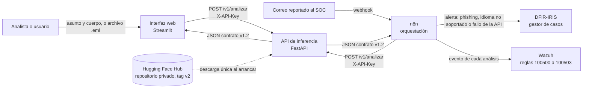
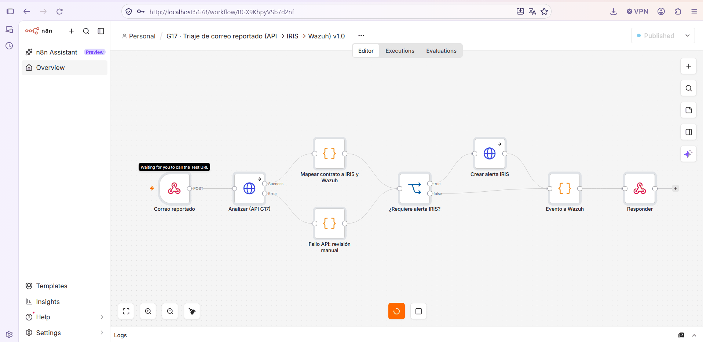
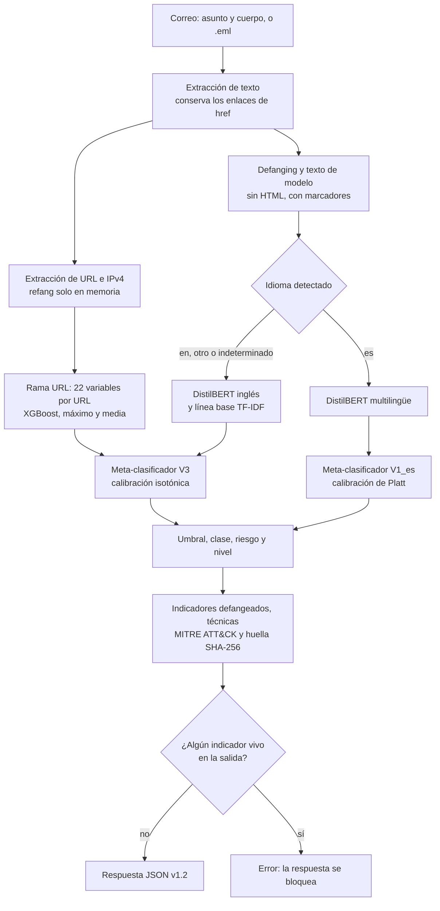

# Arquitectura del modelo y del sistema

Este documento describe qué modelo se eligió y por qué, cómo está construido cada componente, cómo
fluye un correo desde la entrada hasta la respuesta y con qué tecnologías se despliega. Los números
de entrenamiento y validación provienen de `notebooks/03_modelado.ipynb` y
[`results/metrics/modelado_resumen.json`](../results/metrics/modelado_resumen.json); los de prueba,
de `notebooks/05_evaluacion.ipynb`.

## 1. Tipo de modelo y justificación

El problema es una **clasificación supervisada multiclase** (legítimo, spam o phishing) sobre datos
de dos naturalezas: el texto del correo, no estructurado, y las URL que contiene, que se pueden
describir con variables tabulares. Ningún modelo único cubre bien ambas, así que se eligió una
**fusión tardía**: cada rama produce probabilidades por su cuenta y un meta-clasificador las combina.

| Componente | Modelo | Por qué |
|---|---|---|
| Línea base de texto | TF-IDF de palabras y caracteres con regresión logística | Rápida, interpretable por coeficientes y difícil de superar en textos con vocabulario característico |
| Rama de texto principal | DistilBERT ajustado | Captura contexto (urgencia, suplantación) que una bolsa de palabras no representa; es un 40 % más pequeño que BERT y permite inferir en CPU en menos de un segundo |
| Rama URL | XGBoost sobre 22 variables léxicas y el dominio de primer nivel | Señal independiente del texto; modelo eficiente para datos tabulares y explicable por importancia de variables. Se calcula solo desde la cadena, sin resolver ni visitar la URL |
| Fusión | Regresión logística calibrada (isotónica) sobre las salidas de las ramas | Combina señales complementarias y produce una probabilidad confiable, necesaria para fijar umbrales con un costo de error conocido |

**Por qué fusión y no un solo modelo.** Fuera de la distribución de entrenamiento, las ramas fallan en
lugares distintos. Con phishing_pot fuera del entrenamiento, el texto solo detectaba el 26,5 % de ese
phishing mientras la rama URL alcanzaba un AUC de 0,947 sobre los mismos correos. La selección final
se hizo con ese criterio (decisión D10): cuatro variantes de fusión, evaluadas en cuatro pliegues en
los que una fuente o un periodo completo queda fuera del entrenamiento.

| Phishing no visto (recall con FPR de hasta 1 % en validación) | V0: línea base | V1: DistilBERT | V2: DistilBERT y URL | **V3: las tres ramas** |
|---|---:|---:|---:|---:|
| phishing_pot fuera | 68,5 % | 73,6 % | 83,5 % | **83,5 %** |
| Nigerian_Fraud fuera | 91,7 % | 84,8 % | 67,8 % | **94,1 %** |
| Nazario anual fuera | 95,5 % | 96,3 % | 96,3 % | **97,4 %** |
| Phishing desde 2025 fuera | 93,3 % | 94,1 % | 97,9 % | **98,6 %** |
| **Promedio** | 87,3 % | 87,2 % | 86,4 % | **93,4 %** |

V3 es la mejor o empata en los cuatro pliegues. En la partición aleatoria, en cambio, las tres
opciones rinden casi igual (F1 macro entre 0,987 y 0,990, sin diferencias significativas según la
prueba de McNemar); el aporte de la fusión es la robustez ante fuentes nuevas y un puntaje calibrado.

## 2. Componentes en detalle

### 2.1 Línea base: TF-IDF y regresión logística

| Elemento | Configuración |
|---|---|
| N-gramas de palabras | 1 y 2; `min_df` 3; `max_df` 0,9; hasta 100.000 términos |
| N-gramas de caracteres | 3 a 5; `min_df` 5; hasta 100.000 términos |
| Clasificador | Regresión logística multinomial, C = 8 (elegido en validación entre 0,5, 2 y 8), pesos de clase balanceados, 2.000 iteraciones |
| Entrada | Asunto y cuerpo procesados por `texto_para_modelo`, truncados a 5.000 caracteres |
| Validación | F1 macro 0,9873; recall de phishing 0,9792 |

### 2.2 DistilBERT

| Elemento | Configuración |
|---|---|
| Modelo base | `distilbert-base-uncased` |
| Arquitectura | 6 capas de transformador, 12 cabezas de atención, dimensión oculta 768, capa intermedia 3.072, cabeza de clasificación de 3 salidas |
| Parámetros | 66.959.619 |
| Vocabulario | 30.527 tokens: los 30.522 del modelo base y los 5 marcadores del pipeline (`__url__`, `__ip__`, `__email__`, `__anio__`, `__dominio_propio__`) |
| Regularización | Dropout 0,1 en capas y atención, 0,2 en la cabeza de clasificación; decaimiento de pesos 0,01 |
| Entrenamiento | 3 épocas, tasa 5e-5 con calentamiento lineal del 10 %, lotes de 32, secuencias de 256 tokens, pérdida con pesos de clase, parada temprana con paciencia 1 sobre el F1 de validación |
| Cómputo | GPU T4 de Colab, unos 4,5 minutos por época |
| Validación | F1 macro 0,9893; recall de phishing 0,9839; la tercera época fue la mejor (0,9841, 0,9880 y 0,9893) |

### 2.3 Rama URL: XGBoost

Cada correo aporta hasta 20 URL. Cada URL se refanga solo en memoria para calcular 22 variables
numéricas y el dominio de primer nivel (TLD), y nunca se resuelve ni se visita.

| Grupo | Variables |
|---|---|
| Longitudes | `url_len`, `host_len`, `path_len`, `query_len`, `max_token_len`, `tld_len` |
| Estructura del host | `n_puntos_host`, `n_subdominios`, `n_guiones_host`, `n_digitos_host`, `ratio_digitos`, `host_es_ip`, `tiene_puerto`, `tiene_punycode`, `entropia_host` |
| Ruta y parámetros | `n_segmentos_path`, `n_params`, `n_especiales`, `tiene_arroba`, `doble_barra_path`, `entropia_resto` |
| Contenido | `n_palabras_sensibles` (*login*, *verify*, *account*, etc.) |
| Categórica | `tld`: los 50 más frecuentes en entrenamiento; el resto se agrupa como `__otro__` |

Hiperparámetros: 334 árboles (número elegido por parada temprana), tasa 0,05, profundidad 6,
submuestreo 0,8 de filas y de columnas, `min_child_weight` 1 y `reg_lambda` 1.

Cada URL hereda la clase de su correo (phishing frente al resto) y ningún dominio de validación o
prueba entra al entrenamiento, para que la rama mida generalización a dominios nuevos y no memoria de
dominios. Por correo se usan el puntaje máximo y el medio de sus URL. AUC por correo en validación:
0,876. Es un clasificador moderado por sí solo; su papel es aportar una señal independiente.

Se descartó entrenar esta rama con PhiUSIIL: las URL legítimas de ese dataset no tienen ruta, de modo
que la sola presencia del esquema y de `www` separaba las clases con AUC de 0,988, y el modelo no
transfería a URL de correos (AUC 0,67, decisión D6).

### 2.4 Fusión y calibración

El meta-clasificador recibe un vector de 10 valores:

* las log-probabilidades de las 3 clases según DistilBERT;
* las log-probabilidades de las 3 clases según la línea base;
* el bloque URL: puntaje máximo, puntaje medio, indicador `sin_url` y logaritmo de 1 más el número de
  URL. Para correos sin URL, los puntajes valen 0,5 (neutro).

Se ajusta sobre la partición de validación, que ninguna rama vio, con este procedimiento
(`src/train.py`, `ajustar_meta_calibrado`):

1. Probabilidades fuera de pliegue en validación (5 pliegues) con calibración de Platt e isotónica.
2. Se elige la calibración de menor puntaje de Brier: isotónica (0,0117 frente a 0,0128).
3. Umbral de validación: el valor más bajo de P(phishing) con FPR de hasta 1 % (0,03899; decisión D9).
4. Ajuste final con toda la validación.

**Umbral operativo.** Con el umbral de validación, el FPR en correo corporativo real (Enron) fue de
12,5 %. Se eligió un umbral operativo de **0,8586** en una mitad de esos correos y se reportó en la otra:
FPR de 1,3 % (IC 95 % 0,8 a 2,2) con recall de phishing de 95,97 % en la prueba (decisión D27). Es el
umbral que usa la API.

**Regla de decisión y riesgo.**

* `riesgo = round(100 × P(phishing))`.
* Si P(phishing) es mayor o igual que el umbral, la clase es phishing; si no, la clase es la más
  probable entre legítimo y spam. Por eso un correo puede salir como spam con riesgo alto: el riesgo
  mide la probabilidad de phishing, no la confianza en la clase asignada.
* Nivel de riesgo: crítico si el riesgo es 90 o más; alto si la clase es phishing con riesgo menor;
  medio si el riesgo está entre 10 y 89 sin ser phishing; bajo por debajo de 10. Las bandas son
  provisionales y deben validarse con analistas.

### 2.5 Ruta en español

| Elemento | Configuración |
|---|---|
| Modelo de texto | `distilbert-base-multilingual-cased` ajustado con el inglés de entrenamiento, el espejo traducido y la partición de entrenamiento nativa en español (experimento E2) |
| Fusión | Variante V1_es: regresión logística binaria sobre las log-probabilidades del texto, calibración de Platt, umbral 0,8469 (FPR de hasta 1 % en validación) |
| Rama URL | Excluida: en correos nativos en español su AUC fue de 0,37 y 0,45, por debajo del azar (decisión D21) |
| Legítimo frente a spam | Lo decide la rama de texto, porque no hay spam nativo para calibrarlo |
| Prueba nativa | Recall de phishing 93,5 %, FPR 3,5 % (IC 95 % 1,9 a 6,6), AUC 0,984 |

### 2.6 Enrutamiento por idioma

El idioma se detecta con `langdetect` (semilla fija) sobre el texto plano. Inglés o idioma
indeterminado (menos de 40 caracteres) van a la ruta inglesa (`en_v3`); español, a la ruta española
(`es_v1`). Cualquier otro idioma se analiza con la ruta inglesa, pero la respuesta incluye la
advertencia `idioma_no_soportado` y el flujo del SOC lo envía a revisión manual.

## 3. Diagrama del sistema





*Flujo de triaje importado en n8n: webhook, llamada a la API, mapeo del contrato, alerta en DFIR-IRIS
cuando corresponde, evento en Wazuh y respuesta. Si la API falla, la rama inferior envía el correo a
revisión manual.*

Todos los servicios corren en `docker-compose` dentro de una red interna sin salida a internet. Solo
la API tiene salida, y únicamente para descargar el modelo la primera vez. Los puertos se publican en
`127.0.0.1`.

## 4. Pipeline de inferencia



Pasos implementados en `src/model.py` (`Detector.analizar`):

1. **Entrada.** Asunto y cuerpo en texto o HTML, o el correo completo en formato RFC 822 (.eml). Si
   llega el .eml, se extraen asunto y cuerpo y se calcula la huella SHA-256 del archivo.
2. **Texto de modelo.** Defanging de URL e IPv4, eliminación del HTML y sustitución de URL, IP,
   direcciones de correo, años y dominios propios por marcadores.
3. **Rama URL.** Hasta 20 URL; variables léxicas y puntaje de XGBoost por URL; máximo y media por
   correo. Las URL vivas no salen de esa función.
4. **Idioma y ruta.** Detección de idioma y elección de la ruta inglesa o española.
5. **Fusión.** Vector del meta-clasificador, probabilidades calibradas y regla de decisión.
6. **Indicadores.** URL e IPv4 defangeadas; T1566 (Phishing) si la clase es phishing y T1566.002
   (Spearphishing Link) si además hay URL.
7. **Control final.** Si la salida serializada contuviera un indicador vivo, se lanza un error y la
   respuesta no se entrega. Es la última barrera del requisito de defanging.

## 5. Contrato de salida

La interfaz entre capas es un JSON versionado (contrato v1.2), validado con JSON Schema
(`contracts/contrato_v1.schema.json`) en la API y en las pruebas automáticas. Ejemplo de formato,
generado con componentes simulados (sus probabilidades no tienen significado):

```json
{
  "version_contrato": "1.2",
  "id_analisis": "cb3587bb-2448-4e02-a19e-19cba50aefb8",
  "timestamp_utc": "2026-10-18T23:29:01+00:00",
  "modelo": {"version": "fusion_v1", "variante": "V3", "umbral_phishing": 0.5},
  "ruta_modelo": "en_v3",
  "correo": {"sha256": "a0ca0b9b...b567b", "asunto_defang": "Account suspended"},
  "clasificacion": {
    "clase": "phishing",
    "riesgo": 100,
    "nivel_riesgo": "critico",
    "probabilidades": {"legitimo": 0.000001, "spam": 0.000003, "phishing": 0.999996}
  },
  "ramas": {
    "texto_distilbert": {"legitimo": 0.02, "spam": 0.03, "phishing": 0.95},
    "texto_baseline": {"legitimo": 0.02, "spam": 0.03, "phishing": 0.95},
    "url": {"max": 1.0, "media": 1.0, "n_urls": 1, "sin_url": false}
  },
  "iocs": {
    "urls": ["hxxps[://]secure-login[.]example[.]com/verify?id=7"],
    "ips": ["192[.]0[.]2[.]4"],
    "n_urls": 1,
    "n_ips": 1
  },
  "mitre_attack": [
    {"tecnica": "T1566", "nombre": "Phishing"},
    {"tecnica": "T1566.002", "nombre": "Spearphishing Link"}
  ],
  "idioma_detectado": "en",
  "advertencias": [],
  "latencia_ms": 263.6
}
```

El contrato no lleva el cuerpo del correo: solo la huella, el asunto defangeado, los indicadores y los
puntajes. El mapeo hacia DFIR-IRIS y Wazuh vive en el flujo de n8n, de modo que el contrato no cambia
según el destino.

## 6. Despliegue

| Servicio | Imagen | Función | Memoria máxima |
|---|---|---|---|
| `api` | `g17/phishing-api:1.1` (construida desde `api/Dockerfile`) | Inferencia; `GET /salud` y `POST /v1/analizar` con clave en `X-API-Key` | 3 GB |
| `ui` | `g17/phishing-ui:1.0` (construida desde `app/Dockerfile`) | Interfaz web en `127.0.0.1:8501` | 512 MB |
| `n8n` | `n8nio/n8n:2.41.6` | Flujo de triaje: API, alerta en IRIS y evento en Wazuh | 1 GB |
| `wazuh` | `wazuh/wazuh-manager:4.14.8` | Reglas propias 100500 a 100503 y registro de alertas | 2 GB |
| DFIR-IRIS | Compose oficial v2.4.29 | Gestor de casos y alertas | cerca de 2,5 GB |

La API arranca descargando los artefactos de la versión `v2` del repositorio privado de Hugging Face
Hub con un token de solo lectura, los deja en un volumen y precalienta ambas rutas (decisión D25). La
primera inferencia sin precalentar tardaba 8,9 s; después del calentamiento, el percentil 95 de punta a
punta es de 275 ms. Las instrucciones paso a paso están en [`deploy/README.md`](../deploy/README.md).

**Demostración pública.** Para que la interfaz se pueda evaluar en remoto, se publica además en
Streamlit Community Cloud (https://phishing-hibrido-g17.streamlit.app). Allí no hay API aparte: el punto de entrada
`nube/streamlit_app.py` ejecuta la misma interfaz en modo `local`, y `app/motor_local.py` carga el mismo
detector desde Hugging Face Hub (con el token guardado como secreto de la plataforma), lo precalienta en
un hilo aparte y valida cada salida contra el contrato v1.2. Es la única plataforma gratuita con
memoria suficiente para los dos DistilBERT (hasta 2,7 GB); Hugging Face Spaces exige PRO para
contenedores en CPU y Render ofrece 512 MB. Detalle en [`nube/README.md`](../nube/README.md).

**Medidas de seguridad del despliegue**

* La API exige una clave y responde 401 sin ella; la clave se lee de variables de entorno y nunca se
  versiona.
* La red del SOC es interna; los puertos solo se publican en `127.0.0.1`.
* Los contenedores propios corren con un usuario sin privilegios.
* Ninguna URL se resuelve ni se visita; todos los indicadores salen defangeados y la API bloquea
  cualquier respuesta con un indicador vivo.
* El flujo de n8n nunca cierra un caso por su cuenta: si la API falla, el correo va a revisión manual.

## 7. Tecnologías y versiones

| Área | Tecnología | Versión |
|---|---|---|
| Lenguaje | Python | 3.13 |
| Aprendizaje profundo | PyTorch (CPU en el despliegue) | 2.11.0 |
| Modelos de lenguaje | Hugging Face Transformers | 5.17.0 |
| Aprendizaje automático | scikit-learn | 1.6.1 |
| Gradient boosting | XGBoost | 3.4.1 |
| Datos | pandas, NumPy, SciPy, PyArrow | 2.2.3, 2.1.3, 1.16.3, 26.0.0 |
| Detección de idioma | langdetect | 1.0.9 |
| Optimización de hiperparámetros | Optuna | 5.0.0 |
| Equidad por subgrupos | Fairlearn | 0.14.0 |
| Gráficos | Matplotlib, Altair | 3.11.2, 6.3.0 |
| API | FastAPI, Uvicorn, Pydantic, jsonschema | 0.143.0, 0.54.0, 2.14.1, 4.26.0 |
| Interfaz | Streamlit, httpx | 1.66.0, 0.28.1 |
| Registro de modelos | huggingface_hub | 1.31.0 |
| Orquestación | n8n | 2.41.6 |
| Gestor de casos | DFIR-IRIS | 2.4.29 |
| SIEM | Wazuh manager | 4.14.8 |
| Pruebas y estilo | pytest, ruff | 9.1.1, 0.16.8 |
| Entrenamiento | Google Colab, GPU T4 | |

Las versiones exactas están fijadas en `requirements.txt`, `api/requirements.txt` y
`app/requirements.txt`.

## Referencias

* Sanh, V., Debut, L., Chaumond, J. y Wolf, T. (2019). DistilBERT, a distilled version of BERT:
  smaller, faster, cheaper and lighter. arXiv:1910.01108. https://arxiv.org/abs/1910.01108
* Chen, T. y Guestrin, C. (2016). XGBoost: A scalable tree boosting system. arXiv:1603.02754.
  https://arxiv.org/abs/1603.02754
* MITRE. T1566: Phishing. MITRE ATT&CK. https://attack.mitre.org/techniques/T1566/
