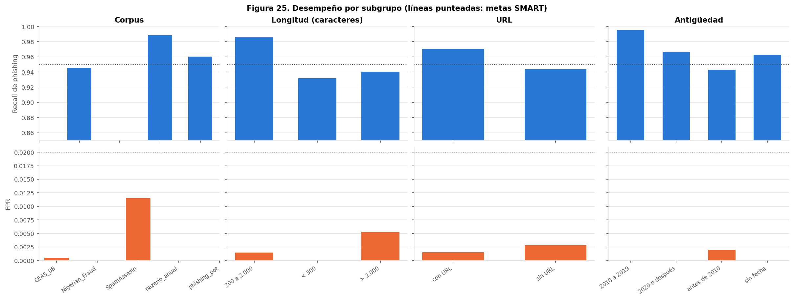

# Consideraciones éticas

Este documento analiza los riesgos éticos del detector y las medidas tomadas para reducirlos. Parte
del Workshop de Impacto Social y Responsabilidad de la Semana 4 (12/10/2026) y lo actualiza con las
mediciones posteriores: el umbral operativo, el análisis por subgrupos con Fairlearn, los escenarios
de estrés de la Semana 5 y la validación con correos reales. Las cifras provienen de
[`results/metrics/evaluacion_final.json`](../results/metrics/evaluacion_final.json) salvo que se indique
otra fuente.

**Principio que guía todo el documento:** el sistema sugiere y el analista decide. Ninguna salida del
modelo cierra un caso, borra un correo ni bloquea un remitente por sí sola.

## 1. Análisis de sesgos

**¿Tiene sesgos el dataset?** Sí, aunque no demográficos: el sistema no recibe ni infiere edad, género,
etnia ni ningún otro atributo de personas. Los sesgos medidos son de fuente, de época, de estilo y de
idioma.

| Sesgo | Evidencia | Cómo afecta a las predicciones |
|---|---|---|
| **De fuente** | Un clasificador predice el corpus de origen con F1 de 0,81 a partir del texto | El modelo puede aprender el estilo de un corpus en lugar del phishing. Con un corpus de phishing nunca visto, el recall baja de cerca de 96 % a 83,5 % |
| **Temporal** | El legítimo es de 2002 a 2008 y el phishing tiene mediana 2023 | Un correo legítimo moderno puede parecer anómalo. Se mitigó enmascarando los años y con un pliegue temporal |
| **De estilo** | El legítimo de entrenamiento son sobre todo listas de correo técnicas | El correo corporativo de oficina no estaba representado: con el umbral de validación, el 12,5 % de los correos de Enron salió como phishing |
| **De idioma** | El corpus base es inglés; el español tiene menos datos y no tiene spam nativo | FPR de 3,5 % en español frente a 0,19 % en la prueba inglesa y 1,3 % en correo corporativo en inglés |
| **De tipo de ataque** | El phishing de entrenamiento es sobre todo masivo | El phishing dirigido de un estilo no visto se detecta mal: con SpearPhishMX fuera del entrenamiento, el recall fue de 7,6 % |
| **De etiqueta** | Solo el 64 % de una muestra revisada de phishing_pot era phishing según el diccionario de etiquetas | Parte del spam se aprende como phishing, lo que eleva los falsos positivos de spam a phishing |

**¿Qué grupos podrían ser perjudicados?**

* **Remitentes legítimos hispanohablantes**, como pymes, proveedores locales o ciudadanos que escriben a
  una institución: asumen más falsos positivos y no tienen voz en el sistema.
* **Personal administrativo y financiero**, blanco habitual del phishing dirigido, que es justo el tipo
  de ataque que el modelo detecta peor.
* **Empleados con menor alfabetización digital**: el sistema solo analiza correos que alguien reporta,
  y quien no reconoce el phishing no lo reporta.
* **Hablantes de otras lenguas** (por ejemplo, kichwa): sus correos no se clasifican con fiabilidad y van
  a revisión manual.

## 2. Equidad

Se midió el recall de phishing y el FPR por subgrupo con `MetricFrame` de Fairlearn, sobre la
partición de prueba y con el umbral operativo. La brecha aceptable se fijó antes de medir: 10 puntos
de recall y 2 puntos de FPR entre subgrupos con al menos 50 correos.

| Dimensión | Subgrupo con menor recall | Brecha de recall | Brecha de FPR | Dentro del límite |
|---|---|---:|---:|---|
| Corpus de origen | Nigerian_Fraud (94,5 %) | 4,3 puntos | 1,1 puntos (SpamAssassin 1,15 % frente a CEAS 0,05 %) | Sí |
| Longitud del texto | Menos de 300 caracteres (93,2 %) | 5,4 puntos | 0,5 puntos | Sí |
| Presencia de URL | Sin URL (94,4 %) | 2,6 puntos | 0,1 puntos | Sí |
| Antigüedad | Anterior a 2010 (94,3 %) | 5,2 puntos | 0,2 puntos | Sí |
| Idioma | Español nativo (93,5 %, con FPR de 3,5 %) | 2,8 puntos frente al inglés | 3,3 puntos frente al inglés | **No** |

*Figura 25. Recall y FPR de phishing por subgrupo con el umbral operativo.*

Todas las brechas en inglés están dentro de los límites, pero cuatro subgrupos quedan por debajo de la
meta de 95 % de recall (textos cortos, correos sin URL, correos anteriores a 2010 y Nigerian_Fraud;
se solapan en parte). La brecha de idioma no cumple: el sistema protege peor a la población
hispanohablante, que es la del contexto de uso previsto.

**Estrategias implementadas**

* Ruta propia para el español, con un modelo multilingüe ajustado con correos nativos y su propio
  umbral, en lugar de aplicar el modelo inglés (que clasificaba como phishing un correo legítimo en
  español).
* Selección del modelo por su desempeño fuera de distribución (pliegues con un corpus completo fuera),
  no por la partición aleatoria.
* Umbral operativo elegido con correo corporativo real para no castigar el estilo de oficina.
* Advertencias en la interfaz cuando el texto es corto o el idioma no está soportado, y revisión manual
  obligatoria de esos casos en el flujo del SOC.

**Pendiente.** Ampliar el legítimo en español (los 9 falsos positivos de la prueba española vienen de
SpaPhish) y medir el FPR por tipo de dominio (de país, gratuito, genérico) antes de cualquier piloto.

## 3. Privacidad

**¿Se usan datos personales?** Sí. Los corpus públicos de entrenamiento contienen correos reales con
nombres y direcciones, y en operación el sistema procesaría correos reportados por empleados, que
pueden incluir datos de terceros.

**Medidas implementadas**

| Medida | Dónde |
|---|---|
| La inferencia corre en un contenedor de la propia organización; los correos no salen de su red | `deploy/docker-compose.yml`, decisión D12 |
| La demostración pública (Streamlit Community Cloud, servidores en Estados Unidos) advierte en pantalla que solo se usen ejemplos o correos de prueba; no se debe usar con correo real de una organización | `nube/README.md`, decisión D32 |
| El repositorio de modelos (privado) guarda solo artefactos, nunca correos | Hugging Face Hub, versión `v2` |
| La respuesta no incluye el cuerpo del correo: solo su huella SHA-256, el asunto defangeado (300 caracteres como máximo), los indicadores y los puntajes | Contrato JSON v1.2 |
| La API no guarda los correos y la interfaz guarda el historial solo en la sesión del navegador, que se borra al cerrarla | `api/app.py`, `app/app.py` |
| Los datos de entrenamiento no se redistribuyen: el repositorio guarda solo sus huellas y los enlaces a las fuentes | `data/README.md` |
| Los correos reales de la validación externa se identifican por su huella y no se copian | `results/metrics/validacion_externa_mta.json` |
| Ninguna URL se resuelve ni se visita, de modo que analizar un correo no avisa al atacante | Todo el pipeline |

**Limitación.** El defanging cubre URL e IPv4, no direcciones de correo: una URL que lleva la dirección
del destinatario en sus parámetros la muestra tal cual en la lista de indicadores, como se vio con los
correos de la validación externa.

**Cumplimiento normativo**

| Norma | ¿Aplica? | Situación |
|---|---|---|
| Ley Orgánica de Protección de Datos Personales del Ecuador (2021) y su Reglamento (2023) | Sí, en una implementación real | Cumplen la minimización y la seguridad. Faltan, antes de un piloto, la evaluación de impacto, el aviso a los titulares en la política de uso del correo y un plazo de retención en el gestor de casos |
| Constitución del Ecuador, art. 66, num. 19 y 21 | Sí | Se respeta si el sistema se limita a los correos que el propio usuario reporta; no debe extenderse al escaneo masivo de buzones |
| Reglamento General de Protección de Datos (UE) | Solo si se tratan datos de residentes en la UE | Las medidas de minimización y seguridad lo cubren en lo técnico; requiere análisis caso a caso |
| Ley de Inteligencia Artificial (UE) | No de forma directa | Riesgo mínimo como filtro de seguridad; pasaría a alto riesgo si se usara para evaluar o sancionar a empleados, uso que se prohíbe en la sección 7 |

Una implementación real requeriría asesoría legal especializada.

## 4. Transparencia y explicabilidad

**¿Es interpretable el modelo?** Por partes.

* **Línea base:** los coeficientes de la regresión logística muestran qué n-gramas empujan hacia cada
  clase (figura 12 del notebook 03).
* **Rama URL:** la importancia de variables de XGBoost muestra qué rasgos de las URL pesan más
  (longitud, presencia de `@`, palabras sensibles y TLD; figura 13).
* **DistilBERT:** es opaco. No se implementaron explicaciones por correo con SHAP o LIME; queda como
  trabajo futuro.

**¿Entienden los usuarios cómo funciona?** La interfaz muestra para cada correo:

* la clase, el riesgo y la probabilidad de cada clase, con un gráfico;
* el detalle por rama (DistilBERT, línea base y puntaje de las URL), para ver qué señal domina;
* los indicadores encontrados, defangeados, y las técnicas de MITRE ATT&CK;
* una recomendación de qué hacer, en lenguaje simple;
* advertencias explícitas cuando el texto es corto o el idioma no está soportado.

La pestaña *Acerca del modelo* explica las tres ramas, las métricas medidas y las limitaciones, y la
pestaña *Ayuda* explica cómo leer el resultado. La ficha del modelo, en el formato de *model cards*
(Mitchell et al., 2019), está en [`models/README.md`](../models/README.md).

**Calibración.** El riesgo de 0 a 100 se puede leer como una probabilidad: el error de calibración es
bajo (ECE 0,0055, Brier 0,0111). Esa calibración se midió en la misma distribución de entrenamiento;
ante phishing de un tipo nuevo, el puntaje puede estar sobreconfiado.

## 5. Impacto social

**Impactos positivos**

* Menos carga y fatiga en el SOC: el analista recibe la cola priorizada, los indicadores extraídos y la
  alerta prellenada. En la prueba de triaje, el tiempo mediano bajó de 24,6 s a 16,6 s por correo
  (estimación con 20 correos y dos analistas, no concluyente).
* Mejores decisiones de personas sin experiencia: con la ayuda del modelo, el analista sin experiencia
  previa en triaje pasó de 50 % a 100 % de aciertos y dejó de omitir phishing.
* Menor ventana de exposición: detectar una campaña antes permite purgarla antes de que más personas
  entreguen sus credenciales.
* Acceso a detección avanzada a costo cero, con software libre, para organizaciones con pocos recursos.

**Impactos negativos posibles**

* **Falsa sensación de seguridad.** Un F1 de 98,7 % puede ocultar que el recall cae a 83,5 % ante un
  corpus nuevo y a 7,6 % ante phishing dirigido en español de un estilo no visto.
* **Falsos positivos sobre comunicación legítima**, más probables en español y en estilos poco
  representados.
* **Sesgo de automatización y pérdida de habilidades.** Las personas tienden a confiar de más en las
  recomendaciones automáticas (Parasuraman y Manzey, 2010). En la prueba de triaje, el analista experto
  contradijo una sugerencia correcta del modelo, y su acierto bajó de 90 % a 80 % con ayuda: la
  supervisión humana también introduce errores y la herramienta cambia la forma de trabajar.
* **Presión sobre el empleo de los analistas de nivel 1** si el ahorro de tiempo se traduce en recortes
  en lugar de dedicar ese tiempo a casos complejos.

**Quiénes se benefician y quiénes podrían salir perjudicados**

| Se benefician | Podrían salir perjudicados |
|---|---|
| Analistas del SOC, sobre todo los que tienen menos experiencia | Remitentes legítimos con falsos positivos, en especial hispanohablantes |
| Empleados protegidos de campañas reportadas por otros | Empleados que reciben phishing dirigido, que el modelo detecta peor |
| Organizaciones con pocos recursos | Analistas, si la herramienta se usa para recortar personal |

## 6. Responsabilidad

**¿Quién responde si el modelo falla?**

| Rol | Responsabilidad | Rendición de cuentas |
|---|---|---|
| Equipo de desarrollo (Grupo 17) | Pipeline correcto, defanging, seguridad de la API, fallo seguro, métricas honestas | Pruebas automáticas, semillas fijas, bitácora de decisiones con evidencia |
| Dueño del producto | Umbrales por defecto y equilibrio entre recall y falsos positivos | Cada cambio de umbral queda registrado con sus datos (decisiones D9 y D27) |
| Analistas del SOC | Decisión final sobre cada correo | Registro de la alerta y de su resolución en DFIR-IRIS |
| Organización (CISO y delegado de protección de datos) | Política de uso, recursos, cumplimiento legal | Aprobación del despliegue, evaluación de impacto, auditoría |

En esta fase académica el sistema es un prototipo: no hay una organización que lo opere y la
responsabilidad por su uso fuera del proyecto recae en quien lo despliegue.

**Mecanismos de rendición de cuentas implementados**

* Cada análisis lleva un `id_analisis`, la versión del modelo, la variante, el umbral vigente, la ruta
  del modelo y la huella del correo, de modo que cualquier decisión se puede reconstruir.
* Los artefactos del modelo están versionados con etiquetas inmutables (`v1`, `v2`) en Hugging Face Hub.
* Cada análisis del flujo del SOC queda como evento en Wazuh y, si requiere acción, como alerta en
  DFIR-IRIS.

**Plan de monitoreo y actualización** (para un piloto, con el marco de gestión de riesgos de IA del
NIST como referencia)

| Señal | Umbral de alerta | Acción |
|---|---|---|
| Cambio en la distribución del riesgo (índice de estabilidad poblacional) | Mayor que 0,2 | Revisar si hay deriva y recalibrar |
| Recall en un conjunto de control con phishing reciente | Caída de más de 5 puntos | Reentrenar con casos confirmados |
| Proporción de decisiones del modelo contradichas por analistas | Más de 15 % semanal | Revisar umbral y casos |
| FPR y recall por idioma y por tipo de dominio | Brecha mayor que el límite fijado | Ajustar datos o umbral por grupo |

Reentrenar solo con etiquetas confirmadas por analistas evita que un atacante envenene el modelo con
reportes falsos. Ante un incidente, el flujo se pasa a modo manual (todo correo a revisión humana)
mientras se investiga.

## 7. Uso dual y mal uso

**¿Podría usarse con fines maliciosos?** Sí, de dos formas:

1. **Como oráculo.** Un atacante con acceso a la API podría modificar su correo hasta obtener un riesgo
   bajo y así diseñar phishing que evada este y otros detectores parecidos.
2. **Como herramienta de vigilancia**, si se usara para escanear de forma masiva los buzones de los
   empleados o para evaluar su comportamiento.

**Salvaguardas implementadas**

* Los pesos del modelo están en un repositorio privado; el acceso se entrega con un token de solo
  lectura, uno por persona y por despliegue, que se revoca al terminar la evaluación. Los pesos no se
  publican.
* La API exige una clave, corre en una red interna y publica su puerto solo en `127.0.0.1`. El puntaje
  nunca se devuelve al remitente del correo.
* La evaluación del proyecto exige una URL pública, así que la interfaz se publica como demostración
  en Streamlit Community Cloud (decisión D32). Allí los pesos siguen privados (la aplicación los lee
  con un token de solo lectura guardado como secreto), cada sesión admite 30 análisis y la integración
  con el SOC no se publica. El límite por sesión es una fricción, no una barrera: el riesgo de uso como
  oráculo se reduce pero no desaparece, y la demostración se puede suspender al terminar la evaluación.
* Los indicadores siempre salen defangeados y la API bloquea cualquier respuesta con un indicador vivo,
  de modo que la herramienta no difunde enlaces maliciosos.
* El código se publica con licencia MIT; los datos de terceros conservan sus propias licencias (por
  ejemplo, phishing_pot es CC BY-NC 4.0 y no admite uso comercial).

**Usos no permitidos**

* Analizar correos de personas que no los han reportado o escanear buzones de forma masiva sin base
  legal.
* Evaluar, puntuar o sancionar a empleados.
* Cerrar casos, borrar correos o bloquear remitentes de forma automática a partir del puntaje.
* Exponer la API del SOC a internet o a usuarios no autenticados.
* Analizar en la demostración pública correos reales con datos personales.
* Usar la herramienta para probar y afinar campañas de phishing.

## 8. Limitaciones reconocidas

**Casos en los que el sistema NO debe usarse o su resultado no es fiable**

| Caso | Por qué | Qué hace el sistema |
|---|---|---|
| Correos en idiomas distintos del inglés y el español | El modelo no se entrenó con ellos | Advertencia `idioma_no_soportado` y revisión manual |
| Textos muy cortos (menos de 300 caracteres) | El recall baja a 93,2 % y, si el texto se trunca a 300 caracteres, a 90,1 % | Aviso en la interfaz cuando el texto se pega; con un archivo .eml el aviso no aparece, porque la interfaz no conoce la longitud antes de analizarlo |
| Phishing dirigido que imita correo corporativo, sobre todo en español | Recall de 7,6 % ante un estilo no visto | Ninguna mitigación técnica; requiere revisión humana |
| Correos cuyo engaño está en un adjunto, una imagen o un código QR | El sistema no analiza adjuntos ni imágenes | Fuera de alcance |
| Campañas de un tipo nunca visto | El recall cae a 83,5 % con un corpus nuevo | Reentrenamiento periódico |
| Decisiones automáticas sin revisión | El recall fuera de distribución no alcanza la meta de 95 % | El flujo nunca cierra casos solo |

**Advertencias para los usuarios**

* El riesgo es la probabilidad de phishing, no la confianza en la clase. Un correo puede salir como
  spam con un riesgo alto si su probabilidad de phishing no alcanza el umbral (0,8586); en ese caso
  conviene revisarlo.
* Un resultado de legítimo no garantiza que el correo sea seguro: el modelo no ve adjuntos, encabezados
  de autenticación ni el contenido de los enlaces.
* La lista de indicadores puede incluir URL inocuas que forman parte del HTML del correo, como la
  declaración de tipo de documento de www[.]w3[.]org.

**Otras limitaciones**

* Los corpus de entrenamiento son públicos, en su mayoría antiguos y con ruido de etiqueta.
* Los correos generados con modelos de lenguaje no están representados de forma explícita, y la
  literatura muestra que los detectores se degradan ante phishing novedoso de ese tipo (Pajola et al.,
  2025).
* La reducción del tiempo de triaje es una estimación con 20 correos y dos analistas; no permite
  afirmar que se cumple la meta de 40 %.
* El FPR en español (3,5 %) supera la meta de 2 %.

## Referencias

* Asamblea Nacional del Ecuador (2021). Ley Orgánica de Protección de Datos Personales. Registro
  Oficial, Quinto Suplemento N.º 459, 26 de mayo de 2021.
* Bird, S., Dudík, M., Edgar, R., Horn, B., Lutz, R., Milan, V., Sameki, M., Wallach, H. y Walker, K.
  (2020). *Fairlearn: A toolkit for assessing and improving fairness in AI* (MSR-TR-2020-32). Microsoft.
* Mitchell, M., Wu, S., Zaldivar, A., Barnes, P., Vasserman, L., Hutchinson, B., Spitzer, E., Raji, I.
  D. y Gebru, T. (2019). Model cards for model reporting. arXiv:1810.03993.
  https://arxiv.org/abs/1810.03993
* National Institute of Standards and Technology (2023). *Artificial Intelligence Risk Management
  Framework (AI RMF 1.0)*, NIST AI 100-1.
* Parasuraman, R. y Manzey, D. H. (2010). Complacency and bias in human use of automation: An
  attentional integration. *Human Factors, 52*(3), 381-410.
* Pajola, L., Caripoti, E., Banzer, S., Pizzi, S., Conti, M. y Apruzzese, G. (2025). E-PhishGen:
  Unlocking novel research in phishing email detection. *ACM AISec '25*.
  https://doi.org/10.1145/3733799.3762967
