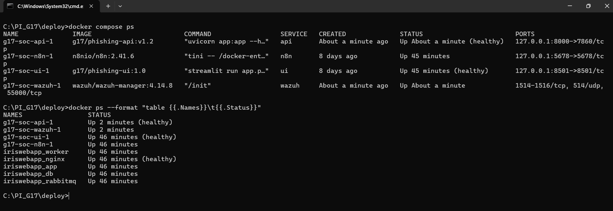
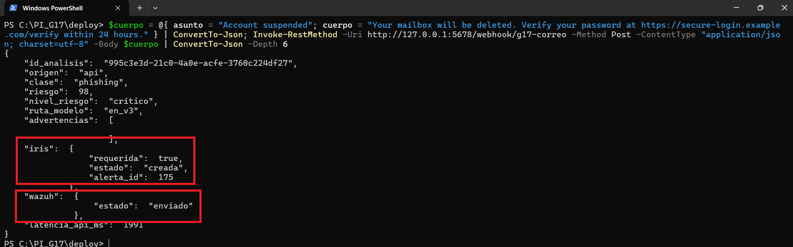
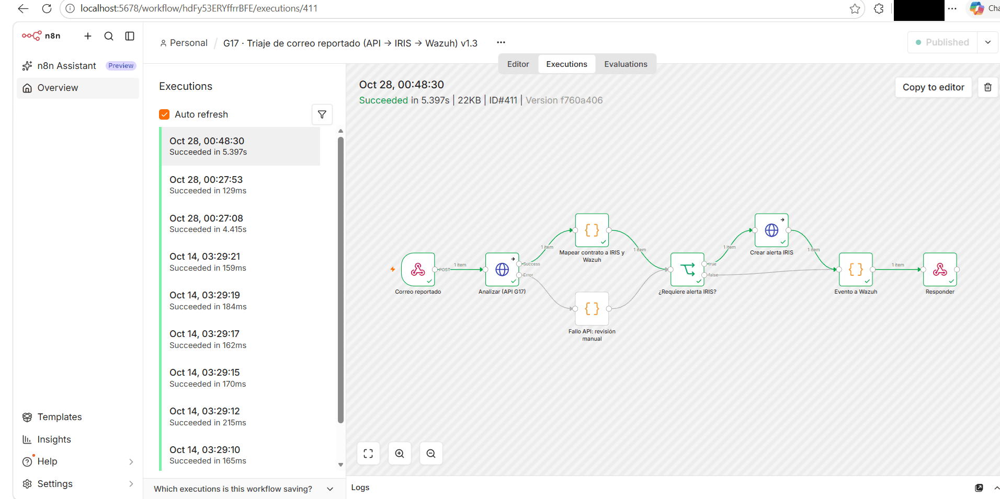
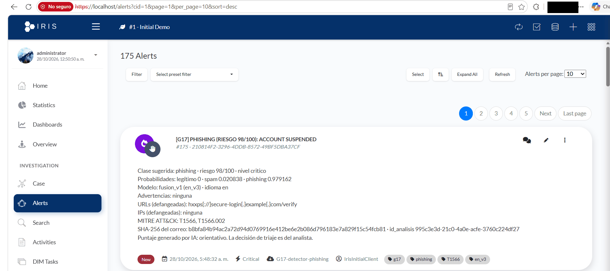
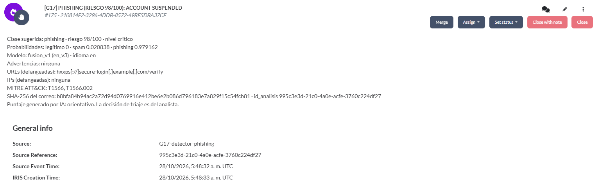
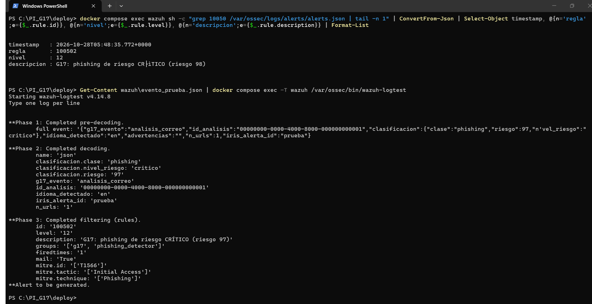
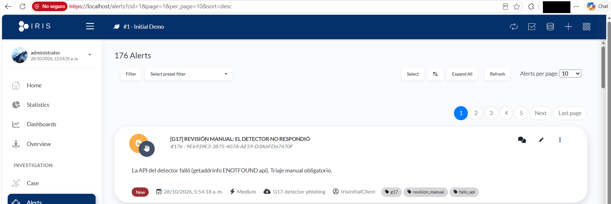
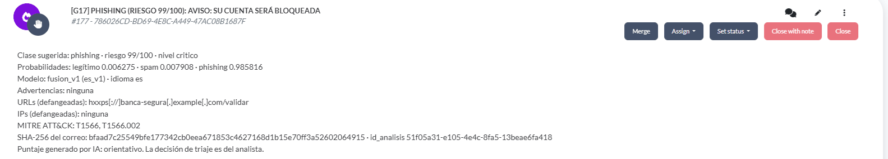
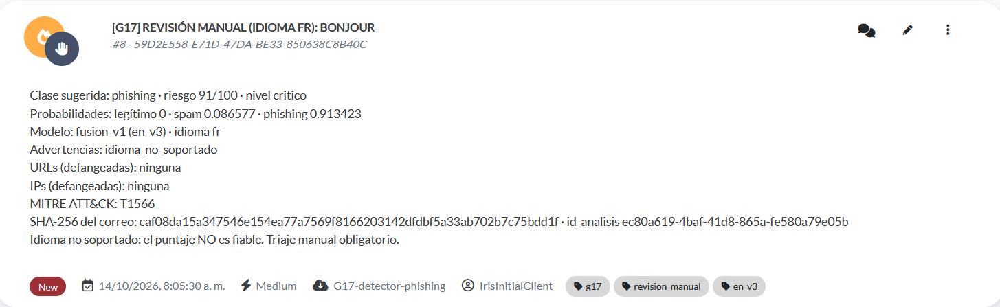

# Evidencia del sistema completo

El objetivo del proyecto fue un sistema de triaje de correos para un centro de operaciones de
seguridad (SOC): el modelo clasifica el correo reportado, la orquestación lo lleva al gestor de casos y
al SIEM, y un analista decide. Ese sistema completo corre en un laboratorio local con
`docker-compose` (`deploy/`). Para la evaluación se publica además una parte: la interfaz con el
modelo, en Streamlit Community Cloud (`nube/`, decisión D32).

Este documento reúne la evidencia de que el ciclo completo funciona y explica qué se publica y por qué.

## 1. El ciclo de triaje

1. Un usuario reporta un correo sospechoso o un analista lo pega en la interfaz.
2. La **API** (FastAPI) lo clasifica y devuelve el contrato JSON v1.2: clase, riesgo de 0 a 100,
   indicadores defangeados, técnica MITRE ATT&CK y advertencias. La API bloquea cualquier respuesta
   con un indicador vivo.
3. **n8n** recibe el correo por un webhook interno, llama a la API y aplica el mapeo del contrato:
   * crea una alerta en **DFIR-IRIS** cuando la clase es phishing, cuando el idioma no está soportado
     (etiqueta `revision_manual`) o cuando la API falla (etiqueta `fallo_api`);
   * envía un evento a **Wazuh**, que lo procesa con las reglas 100500 a 100503.
4. El **analista** revisa la alerta en DFIR-IRIS y decide. El flujo nunca cierra un caso por su cuenta.

| Componente | Función | Configuración |
|---|---|---|
| API de inferencia | Clasificación y contrato de salida | `api/`, `contracts/` |
| Interfaz web | Análisis manual de un correo | `app/` |
| n8n 2.41.6 | Orquestación: API, DFIR-IRIS y Wazuh | `deploy/n8n/` |
| DFIR-IRIS 2.4.29 | Gestor de alertas y casos del analista | Compose oficial, `deploy/README.md` |
| Wazuh 4.14.8 | Reglas y registro de alertas | `deploy/wazuh/g17_rules.xml` |

| Regla de Wazuh | Nivel | Cuándo se dispara |
|---|---:|---|
| 100500 | 3 | Todo correo analizado |
| 100501 | 10 | Phishing, con el número de alerta de DFIR-IRIS |
| 100502 | 12 | Phishing de riesgo crítico |
| 100503 | 5 | Idioma no soportado: revisión manual |

## 2. Qué se publica y qué no

| Parte | Dónde corre | Acceso |
|---|---|---|
| Modelo e interfaz | Streamlit Community Cloud | Público, para la evaluación |
| API, interfaz, n8n, DFIR-IRIS y Wazuh | `docker-compose` local | Solo `127.0.0.1` y una red interna sin salida a internet |

Las herramientas del SOC no se publican. Reciben correos reales y guardan casos e indicadores de una
organización; exponerlas a internet abriría una superficie de ataque y obligaría a repartir
credenciales. Así quedó definido desde la Ficha de Decisión Técnica de la Semana 2. La demostración
pública muestra el modelo, que es el núcleo del proyecto, con los mismos controles: contrato validado,
indicadores defangeados y enlaces nunca visitados.

## 3. Evidencia

### 3.1 Lote de integración (14/10/2026)

Se enviaron 200 correos de prueba al webhook de n8n con el laboratorio completo levantado
(`deploy/pruebas/lote_kpi.py`). Resultados en `results/metrics/kpi/kpi_resumen.json`:

| Medida | Resultado |
|---|---|
| Correos enviados y respuestas HTTP 200 | 200 de 200, sin errores |
| Correos clasificados como phishing | 83 |
| Alertas creadas en DFIR-IRIS | 83 de 83 (100 %; meta: más de 90 %) |
| Eventos enviados a Wazuh | 200 de 200 (100 %) |
| Latencia del flujo, percentiles 50 y 95 | 183 ms y 275 ms |

En la misma muestra, el modelo dejó pasar 2 de los 60 correos de phishing en inglés, que quedaron
como legítimos y por eso no generaron alerta; los 25 correos de phishing en español se detectaron. El
detalle por correo está en `results/metrics/kpi/kpi_resultados.csv`, sin texto de los correos ni
claves.

### 3.2 Recorrido de punta a punta (28/10/2026)

Con el laboratorio levantado se enviaron tres correos de prueba al webhook de n8n y se siguió cada uno
hasta DFIR-IRIS y Wazuh. Las horas de DFIR-IRIS y Wazuh están en UTC; las de la terminal y n8n, en la
hora local del equipo (UTC-5).

**Servicios.** La API, la interfaz, n8n y Wazuh corren en el compose del proyecto, y DFIR-IRIS en su
compose oficial. Los puertos de la API, la interfaz y n8n se publican solo en `127.0.0.1`; los de
Wazuh no se publican en el equipo.

**Correo de phishing en inglés.** El webhook responde con la clase (phishing, riesgo 98, ruta `en_v3`),
la alerta creada en DFIR-IRIS (número 175) y el evento enviado a Wazuh. La API tardó 1.991 ms porque
era la primera solicitud después de arrancarla; la latencia de referencia es la del lote (percentil 95
de 275 ms).

La ejecución de n8n recorre la API, el mapeo del contrato, la creación de la alerta y el evento a
Wazuh, todos en verde. La rama de fallo de la API no se usa en este caso.

En DFIR-IRIS la alerta llega con severidad crítica, las etiquetas `g17`, `phishing`, `T1566` y
`en_v3`, la URL defangeada, la huella SHA-256 del correo y la aclaración de que el puntaje es
orientativo y la decisión es del analista.

Wazuh registró el evento dos segundos después con la regla 100502 (nivel 12, phishing de riesgo
crítico). La segunda parte de la captura es la prueba con `wazuh-logtest`, que muestra la
decodificación del evento y el mapeo a MITRE ATT&CK (T1566, Initial Access). La palabra CRÍTICO se ve
mal en la primera salida por la codificación de la consola de Windows; en `wazuh-logtest` se ve bien.

**Fallo de la API.** Con la API detenida (`docker compose stop api`), el mismo correo genera la alerta
176: revisión manual obligatoria, severidad media y etiqueta `fallo_api`. El caso no se pierde ni se
cierra solo.

**Correo de phishing en español.** Con la API de nuevo arriba, un correo en español se clasifica por la
ruta `es_v1` (riesgo 99) y genera la alerta 177, con la URL defangeada y las técnicas T1566 y
T1566.002.

### 3.3 Diseño del flujo de n8n

El flujo versionado es `deploy/n8n/g17_flujo_triaje.json`. Se genera a partir de los nodos de código
de `deploy/n8n/codigo/` y las pruebas de `tests/test_flujo_n8n.py` verifican que coincide con su
generador, que todas sus conexiones existen, que no contiene claves y que un fallo de la API nunca
cierra un caso.

### 3.4 Idioma no soportado (14/10/2026)

Alerta creada por el flujo para un correo en francés. El modelo le asignó riesgo 91, pero como el
idioma no está soportado, el flujo no la etiqueta como phishing: la envía a revisión manual (etiqueta
`revision_manual`, severidad media) con la advertencia de que el puntaje no es fiable. Es la
salvaguarda que se describe en `docs/consideraciones_eticas.md`.

### 3.5 Tiempo de triaje

Con 20 correos y dos analistas, la mediana del tiempo de triaje bajó de 24,6 s a 16,6 s con la
sugerencia del modelo (32,4 %). Con esa muestra el intervalo de confianza del 95 % va de -25,2 % a
68,0 %, así que el resultado es una estimación no concluyente
(`results/metrics/kpi/triaje_resumen.json`).

## 4. Cómo reproducirlo

`deploy/README.md` describe el despliegue paso a paso: DFIR-IRIS, la API, la interfaz, n8n y Wazuh, las
pruebas de conectividad, la importación del flujo y la medición de los KPI.
`deploy/pruebas/simuladores.py` permite probar el flujo de n8n sin el modelo ni el SOC completos.
