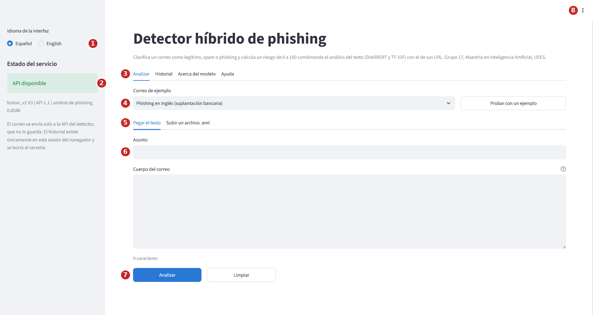
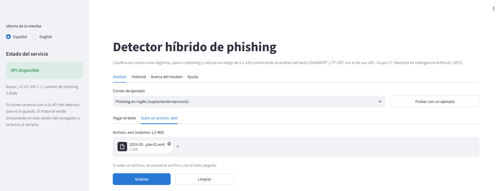
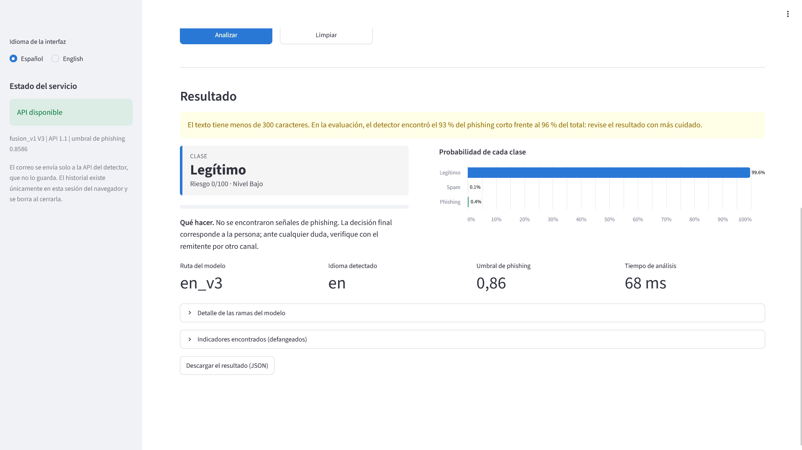
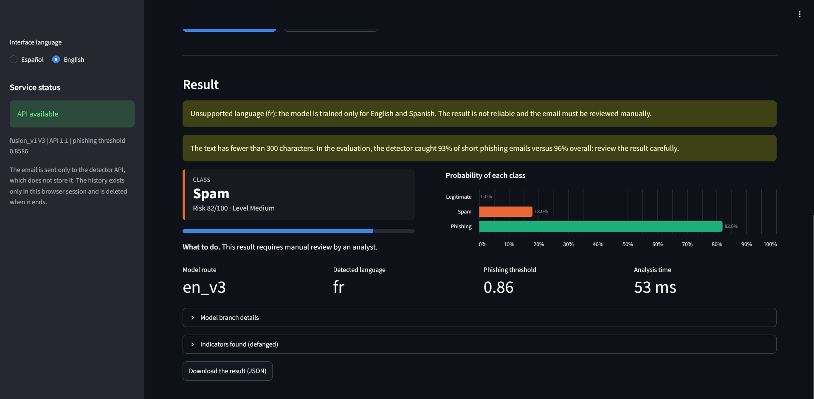
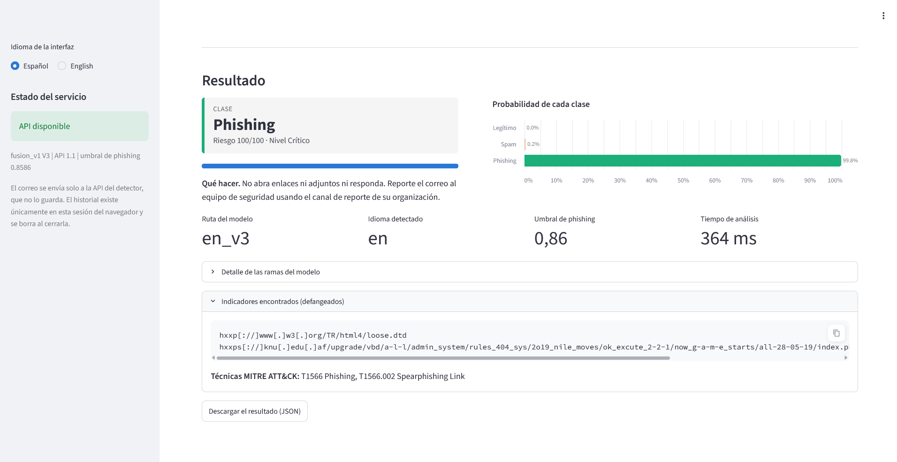
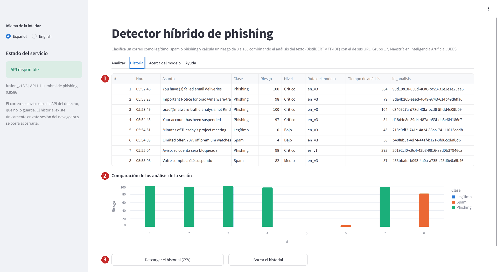
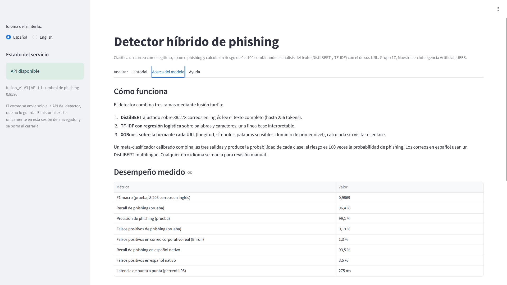
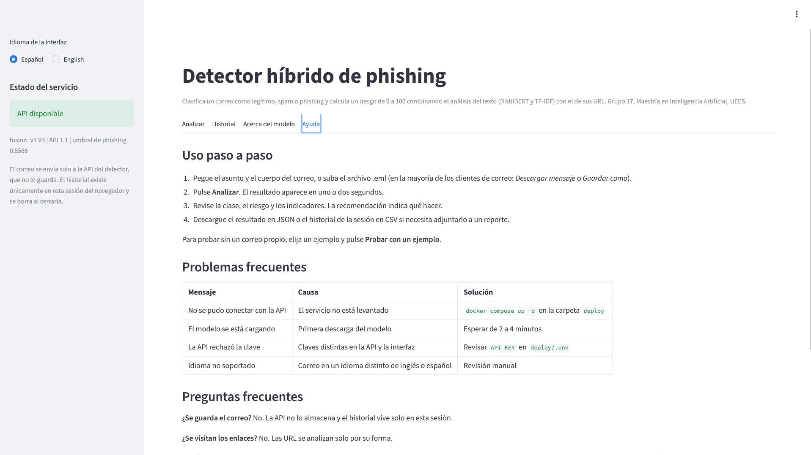

# Manual de usuario

Guía para usar la interfaz web del detector híbrido de phishing. Está pensada para analistas de un
centro de operaciones de seguridad y para cualquier persona que quiera comprobar si un correo es
legítimo, spam o phishing. No hace falta saber programar.

**Antes de empezar, una regla:** el resultado es una ayuda para decidir, no una decisión. Ante la duda,
el correo se revisa a mano.

## 1. Acceso a la interfaz

**Demostración en línea.** La forma más rápida de probarla es abrir **https://phishing-hibrido-g17-myyvrqmmvunvru7bg4yeou.streamlit.app** en el
navegador. No hace falta instalar nada. Tenga en cuenta que:

* la primera visita después de un periodo sin uso tarda unos minutos: si aparece el botón *Yes, get
  this app back up!*, púlselo; luego la barra lateral muestra *Cargando el modelo* hasta que cambia a
  *Modelo disponible*;
* los servidores están en Estados Unidos: use los ejemplos o correos de prueba, nunca correos reales
  con datos personales;
* cada sesión admite 30 análisis;
* la demostración no incluye la integración con n8n, DFIR-IRIS y Wazuh.

**Despliegue local.** La interfaz también forma parte del despliegue local del proyecto. Con el entorno
levantado (instrucciones en
[`deploy/README.md`](../deploy/README.md)), se abre en el navegador:

```
http://localhost:8501
```

Para levantar solo la API y la interfaz, desde la carpeta `deploy/`:

```bash
docker compose up -d api ui
```

La primera vez, la API descarga el modelo (entre 2 y 5 minutos) y la interfaz arranca cuando la API
está lista.

Para ejecutarla sin Docker, con la API ya disponible en otra dirección:

```bash
cd app
pip install -r requirements.txt
export G17_API_URL=http://localhost:8000
export G17_API_KEY=<clave de la API>
streamlit run app.py
```

## 2. La pantalla principal



| N.º | Elemento | Para qué sirve |
|---:|---|---|
| 1 | Idioma de la interfaz | Cambia todos los textos entre español e inglés. No afecta al idioma del correo que se analiza |
| 2 | Estado del servicio | Verde: la API responde y el modelo está listo. Debajo se muestran la versión del modelo y el umbral de phishing vigente |
| 3 | Pestañas | *Analizar*, *Historial*, *Acerca del modelo* y *Ayuda* |
| 4 | Correo de ejemplo | Elija uno de los cinco ejemplos y pulse **Probar con un ejemplo** para cargarlo en el formulario |
| 5 | Forma de entrada | *Pegar el texto* (asunto y cuerpo) o *Subir un archivo .eml* |
| 6 | Asunto y cuerpo | Admiten texto o HTML. Las URL pueden venir defangeadas (`hxxps[://]...`) |
| 7 | Analizar y Limpiar | **Analizar** envía el correo; **Limpiar** vacía el formulario |
| 8 | Menú de tres puntos | Tema: *System* (el del sistema operativo), *Light* o *Dark* |

## 3. Analizar un correo paso a paso

1. **Elija la forma de entrada.**
   * *Pegar el texto*: copie el asunto y el cuerpo desde su cliente de correo. Debajo del cuerpo se
     muestra el número de caracteres.
   * *Subir un archivo .eml*: en la mayoría de los clientes, la opción se llama *Descargar mensaje*,
     *Guardar como* o *Mostrar original*. El archivo puede pesar hasta 1,5 MB. Si sube un archivo, se
     analiza el archivo y no el texto pegado.
2. **Pulse Analizar.** Mientras el correo se procesa aparece el indicador *Analizando el correo...*. El
   resultado suele tardar menos de un segundo.
3. **Lea el resultado** (sección 4) y siga la recomendación.
4. **Guarde la evidencia** si la necesita: el botón *Descargar el resultado (JSON)* entrega la salida
   completa, con su identificador de análisis.



*Archivo .eml cargado, listo para analizar.*

## 4. Cómo leer el resultado


| N.º | Elemento | Qué significa |
|---:|---|---|
| 1 | Clase, riesgo y nivel | La clase asignada (legítimo, spam o phishing), el riesgo de 0 a 100 y su nivel. El color del borde corresponde a la clase |
| 2 | Barra de riesgo | Representación visual del riesgo |
| 3 | Qué hacer | Recomendación según la clase y las advertencias |
| 4 | Probabilidad de cada clase | Las tres probabilidades del modelo; suman 100 % |
| 5 | Datos del análisis | Ruta del modelo (`en_v3` para inglés, `es_v1` para español), idioma detectado, umbral de phishing y tiempo de análisis |
| 6 | Detalle de las ramas | Lo que dice cada rama por separado: DistilBERT, TF-IDF y el puntaje de las URL. Sirve para ver qué señal domina |
| 7 | Indicadores encontrados | URL e IP del correo, siempre defangeadas, y las técnicas de MITRE ATT&CK asociadas. Se pueden copiar con el botón de la esquina |
| 8 | Descargar el resultado | Salida completa en JSON (contrato v1.2) |

### 4.1 Riesgo, clase y nivel

* **El riesgo es la probabilidad de phishing multiplicada por 100.** Un riesgo de 97 significa que el
  modelo estima un 97 % de probabilidad de que el correo sea phishing. La calibración se verificó en la
  evaluación: el riesgo se puede leer como una probabilidad.
* **La clase phishing se asigna solo si el riesgo alcanza el umbral** (0,8586, es decir, 86). Por debajo
  del umbral, la clase es la más probable entre legítimo y spam.
* **Por eso un correo puede salir como spam con un riesgo alto.** El riesgo mide la probabilidad de
  phishing, no la confianza en la clase. Un correo de spam con riesgo 82 tiene un 82 % de probabilidad
  estimada de ser phishing pero no llegó al umbral: conviene revisarlo.

| Nivel | Condición | Acción sugerida |
|---|---|---|
| Crítico | Riesgo de 90 o más | No abrir enlaces ni adjuntos; reportar al equipo de seguridad |
| Alto | Clase phishing con riesgo menor que 90 | Igual que crítico |
| Medio | Riesgo entre 10 y 89 sin ser phishing | Revisar con atención |
| Bajo | Riesgo menor que 10 | Sin señales de phishing; la decisión final es de la persona |

Las bandas son provisionales y deben validarse con los analistas de cada organización.

### 4.2 Advertencias

La interfaz muestra un recuadro amarillo antes del resultado en dos casos:

* **Texto corto.** Si el texto pegado tiene menos de 300 caracteres. En la evaluación, el detector
  encontró el 93 % del phishing corto frente al 96 % del total. Con un archivo .eml el aviso no aparece,
  porque la interfaz no conoce la longitud del texto antes de analizarlo.
* **Idioma no soportado.** Si el correo no está en inglés ni en español. El resultado no es fiable y la
  recomendación pasa a ser *revisión manual por un analista*.



*Correo legítimo de 241 caracteres: clase legítimo con riesgo 0, y aviso de texto corto.*



*Correo en francés: aviso de idioma no soportado y de texto corto. El modelo estimó 82 % de
probabilidad de phishing, por debajo del umbral, así que la clase es spam con nivel medio; la
recomendación es revisión manual.*

### 4.3 Ejemplo con un correo real



*Correo de phishing real publicado por malware-traffic-analysis.net (05/05/2020), subido como .eml:
clase phishing, riesgo 100.*

La lista de indicadores puede incluir URL inocuas que forman parte del HTML del correo, como la
declaración de tipo de documento de `hxxp[://]www[.]w3[.]org/TR/html4/loose.dtd`, o enlaces de
redirección que agregan los clientes de correo. No significan que esos sitios sean maliciosos. Las URL
también pueden mostrar la dirección del destinatario en sus parámetros: el defanging cubre URL e IPv4,
no direcciones de correo.

## 5. Historial de la sesión



| N.º | Elemento | Qué muestra |
|---:|---|---|
| 1 | Tabla | Cada análisis de la sesión: hora, asunto defangeado, clase, riesgo, nivel, ruta, tiempo en milisegundos e identificador |
| 2 | Comparación | Gráfico del riesgo de cada análisis, coloreado por clase. Al pasar el cursor sobre una barra se ven sus datos |
| 3 | Botones | **Descargar el historial (CSV)** y **Borrar el historial** |

El historial existe solo en la sesión del navegador: se borra al cerrar la pestaña. La API no guarda los
correos.

## 6. Acerca del modelo y Ayuda



*La pestaña Acerca del modelo explica las tres ramas, muestra las métricas medidas y enumera las
limitaciones y el uso aceptable.*



*La pestaña Ayuda repite el uso paso a paso, los problemas frecuentes y las preguntas frecuentes.*

## 7. Idioma de la interfaz y tema

* **Idioma:** el selector de la barra lateral cambia toda la interfaz a inglés o español.
* **Tema:** en el menú de tres puntos (arriba a la derecha), elija *System*, *Light* o *Dark*. Por
  defecto la interfaz sigue la preferencia del sistema operativo.


*Interfaz en inglés con tema oscuro y el ejemplo en francés cargado.*

## 8. Correos de ejemplo

| Ejemplo | Qué muestra |
|---|---|
| Phishing en inglés (suplantación bancaria) | Detección de phishing con URL e indicadores |
| Legítimo en inglés (acta de reunión) | Clase legítimo y aviso de texto corto |
| Spam en inglés (oferta comercial) | Clase spam con riesgo bajo |
| Phishing en español (bloqueo de cuenta) | Uso de la ruta española (`es_v1`) |
| Otro idioma (francés): requiere revisión manual | Advertencia de idioma no soportado y revisión manual |

Todos los ejemplos usan dominios reservados para documentación y vienen defangeados.

## 9. Problemas frecuentes

| Mensaje o síntoma | Causa probable | Solución |
|---|---|---|
| *La API no responde* en la barra lateral, o *No se pudo conectar con la API del detector* | El servicio de la API no está levantado o la interfaz apunta a otra dirección | Ejecute `docker compose up -d` en `deploy/` y compruebe con `docker compose ps` que `api` esté *healthy*. Fuera de Docker, revise `G17_API_URL` |
| *La API responde, pero el modelo aún se está cargando* | Primera descarga del modelo | Espere de 2 a 5 minutos y vuelva a intentarlo |
| *La API rechazó la clave* | La clave de la interfaz no coincide con la de la API | Revise `API_KEY` en `deploy/.env` (o `G17_API_KEY` si la interfaz corre fuera de Docker) y reinicie con `docker compose up -d` |
| *La API tardó demasiado en responder* | Equipo sin memoria suficiente o primera inferencia | Intente de nuevo; si persiste, revise la memoria asignada a Docker |
| *Escriba el asunto o el cuerpo del correo, o suba un archivo .eml* | Formulario vacío | Pegue el correo o suba el archivo |
| *El archivo supera 1,5 MB* | Correo con adjuntos grandes | Guarde el correo sin adjuntos o pegue el texto |
| *El asunto supera los 1.000 caracteres* o *El cuerpo supera los 500.000 caracteres* | Entrada demasiado larga | Recorte el texto |
| *La API rechazó el contenido enviado* | El archivo no es un .eml válido | Exporte de nuevo el mensaje en formato .eml |
| *La API tuvo un error interno* o *La API devolvió una respuesta que no cumple el contrato* | Error del servicio | Revise los registros con `docker compose logs api` y repórtelo (sección 11) |

## 10. Preguntas frecuentes

**¿Se guarda el correo que analizo?**
No. Se envía solo a la API del detector, que lo procesa en memoria y no lo guarda. El historial de la
interfaz existe solo en la sesión del navegador.

**¿El sistema abre los enlaces del correo?**
No. Las URL se analizan solo por su forma (longitud, símbolos, palabras, dominio) y nunca se resuelven ni
se visitan. Todos los indicadores se muestran defangeados para evitar clics accidentales.

**¿Qué idiomas soporta?**
Inglés y español. Cualquier otro idioma se marca como no soportado y debe revisarse a mano.

**Un correo salió como legítimo, ¿puedo confiar en él?**
El resultado indica que el modelo no encontró señales de phishing en el texto ni en las URL. No revisa
adjuntos, imágenes ni encabezados de autenticación. Si algo le parece extraño, confirme con el remitente
por otro canal.

**¿Por qué un correo salió como spam con un riesgo alto?**
Porque el riesgo es la probabilidad de phishing y la clase phishing solo se asigna desde el umbral de 86.
Vea la sección 4.1.

**¿Qué significa la ruta del modelo?**
`en_v3` es la ruta inglesa (DistilBERT, TF-IDF y rama URL); `es_v1` es la ruta española (DistilBERT
multilingüe). Los idiomas no soportados usan la ruta inglesa con una advertencia.

**¿Puedo usar la herramienta para probar mis propios correos de phishing?**
No. Usarla para afinar campañas hasta evadir la detección es un uso no permitido.

## 11. Soporte

* **Errores y sugerencias:** abra un *issue* en el repositorio de GitHub del proyecto, con el mensaje
  de error, el `id_analisis` si lo hay y los pasos para reproducirlo. No adjunte correos reales con datos
  personales ni claves.
* **Equipo:** Dennys Francisco Salazar Domínguez y Lenin Bolívar González Rivadeneira, Grupo 17,
  Maestría en Inteligencia Artificial, Universidad de Especialidades Espíritu Santo.
