# Optimización de hiperparámetros y análisis de sensibilidad

Este documento aplica los dos workshops de la Semana 5 al detector. El Workshop 2 (*análisis de
sensibilidad de hiperparámetros*) se ejecutó en `notebooks/04_optimizacion.ipynb` y el Workshop 1
(*simulación de escenarios críticos*), en `notebooks/05_evaluacion.ipynb`. Las cifras están en
[`results/metrics/optimizacion_resumen.json`](../results/metrics/optimizacion_resumen.json), en los
registros de cada prueba
([`optimizacion_pruebas_url.csv`](../results/metrics/optimizacion_pruebas_url.csv) y
[`optimizacion_pruebas_baseline.csv`](../results/metrics/optimizacion_pruebas_baseline.csv)) y en
[`results/metrics/evaluacion_final.json`](../results/metrics/evaluacion_final.json).

**Pregunta guía.** ¿Qué hiperparámetros merecen presupuesto de búsqueda y cuáles se pueden fijar?

## 1. Método

1. **Búsqueda bayesiana** con Optuna (muestreador TPE, semilla 17), usando validación cruzada solo
   sobre la partición de entrenamiento.
2. **Análisis de sensibilidad** con tres herramientas: importancia de hiperparámetros (fANOVA),
   efecto individual (gráfico *slice* y dependencia parcial con un modelo sustituto de bosque
   aleatorio) e interacciones (contorno y dependencia parcial en dos dimensiones).
3. **Comparación antes y después** con validación cruzada repetida sobre los mismos pliegues,
   intervalo de confianza por bootstrap de la mejora media y prueba de Wilcoxon de rangos con signo.
4. **Prueba final** una sola vez, sobre la partición de prueba.

**Criterio de adopción, fijado antes de ver resultados.** La configuración optimizada reemplaza a la
actual solo si el límite inferior del intervalo de confianza al 95 % de la mejora es mayor que cero.
Una diferencia que cabe dentro del intervalo no justifica cambiar un modelo ya desplegado y medido de
punta a punta.

**Qué se optimizó y qué no.**

| Componente | Estudio | Métrica objetivo | Validación cruzada | Presupuesto |
|---|---|---|---|---|
| Rama URL (XGBoost) | A | Precisión promedio (AUC-PR) de phishing | 5 pliegues agrupados por dominio | 60 pruebas, 30 min como máximo |
| Línea base (TF-IDF y regresión logística) | B | F1 macro | 3 pliegues estratificados sobre una muestra de 6.000 correos de entrenamiento | 30 pruebas, 25 min como máximo |
| DistilBERT | No se optimizó | | | Cada ajuste fino cuesta unos 13 minutos de GPU T4; 60 pruebas superarían las 13 horas |

Para DistilBERT se usaron los valores estándar de ajuste fino (tasa 5e-5, 3 épocas, calentamiento
del 10 %) con parada temprana. Su regularización se diagnosticó en la Semana 3 con curvas de
aprendizaje y de validación (`notebooks/experimentos/16_diagnostico_sobreajuste.ipynb` y
`results/figures/semana3/`).

## 2. Estudio A: rama URL

### 2.1 Espacio de búsqueda

| Hiperparámetro | Rango | Escala | Configuración actual |
|---|---|---|---|
| `max_depth` | 2 a 12 | entera | 6 |
| `learning_rate` | 0,01 a 0,3 | logarítmica | 0,05 |
| `n_estimators` | 100 a 1.000 | entera, paso 50 | 334 (parada temprana) |
| `min_child_weight` | 1 a 20 | logarítmica | 1 |
| `subsample` | 0,5 a 1,0 | lineal | 0,8 |
| `colsample_bytree` | 0,5 a 1,0 | lineal | 0,8 |
| `reg_lambda` | 0,001 a 10 | logarítmica | 1 |

Los pliegues se agrupan por dominio: ningún dominio aparece a la vez en el ajuste y en la evaluación
de un pliegue, igual que en el diseño de la rama.

### 2.2 Resultados de la búsqueda

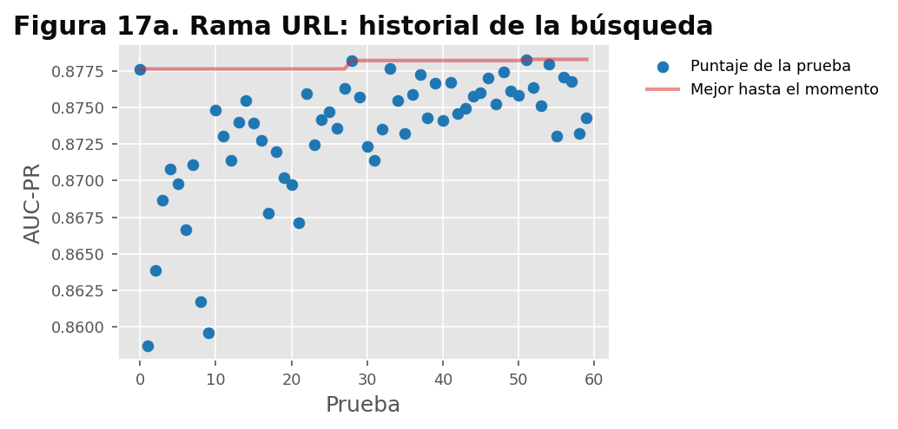

*Figura 17a. AUC-PR de cada prueba y mejor valor acumulado.*

Las 60 pruebas van de 0,859 a 0,878: menos de dos puntos entre la peor y la mejor configuración. La
mediana (0,874) queda a 0,4 puntos del máximo, y la configuración actual obtuvo 0,8757 en la misma
validación cruzada. El modelo es poco sensible a sus hiperparámetros dentro de rangos amplios.

### 2.3 Importancia de hiperparámetros

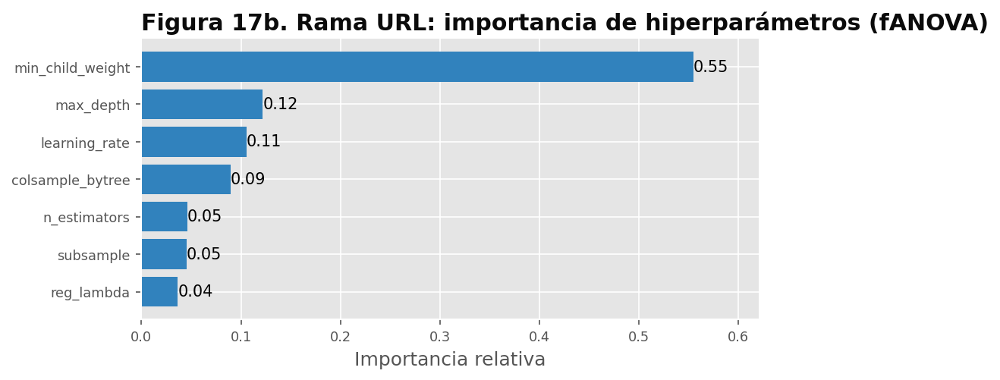

*Figura 17b. Importancia relativa de cada hiperparámetro según fANOVA.*

| Puesto | Hiperparámetro | Importancia | Efecto observado |
|---:|---|---:|---|
| 1 | `min_child_weight` | 0,55 | Los mejores valores están cerca de 1; el puntaje cae de forma marcada por encima de 2 |
| 2 | `max_depth` | 0,12 | Efecto pequeño; profundidades de 4 a 7 rinden igual |
| 3 | `learning_rate` | 0,11 | Plano entre 0,02 y 0,1 |
| 4 | `colsample_bytree` | 0,09 | Plano |
| 5 | `n_estimators` | 0,05 | Sin efecto práctico |
| 6 | `subsample` | 0,05 | Sin efecto práctico |
| 7 | `reg_lambda` | 0,04 | Sin efecto práctico |

### 2.4 Efectos individuales

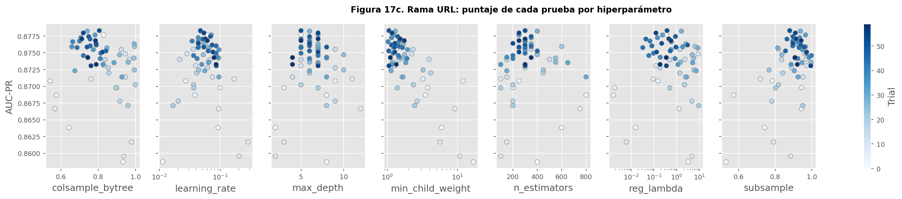

*Figura 17c. Puntaje de cada prueba según el valor de cada hiperparámetro.*

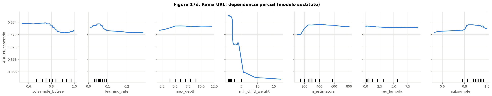

*Figura 17d. Dependencia parcial del AUC-PR esperado, estimada con un bosque aleatorio entrenado
sobre las 60 pruebas.*

La dependencia parcial confirma el ranking: solo la curva de `min_child_weight` tiene una caída
apreciable; las demás son casi planas en todo su rango.

### 2.5 Interacciones

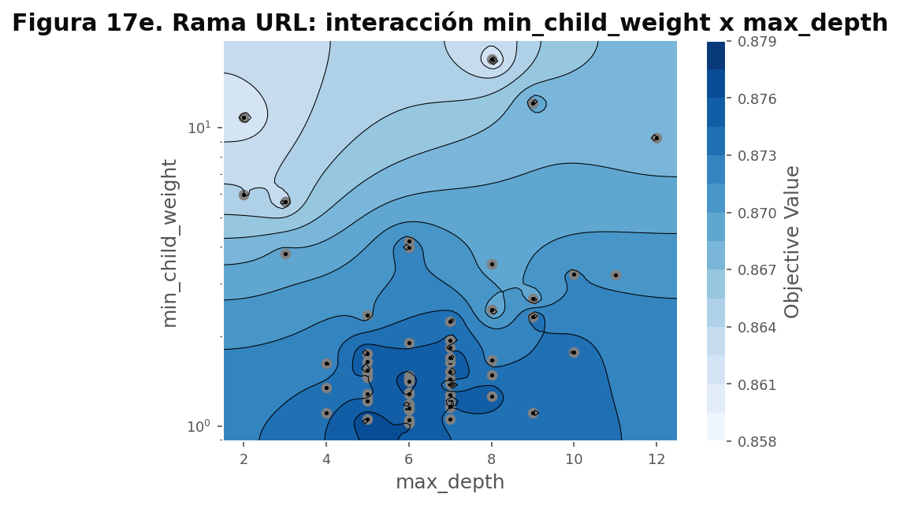

*Figura 17e. Contorno de `min_child_weight` y `max_depth` con las pruebas realizadas.*

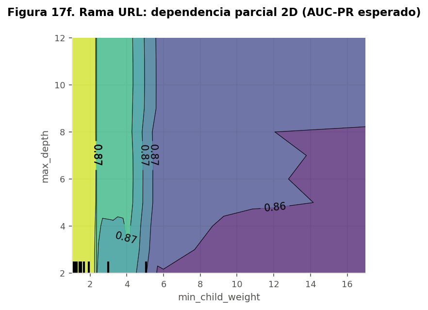

*Figura 17f. Dependencia parcial conjunta de `min_child_weight` y `max_depth`.*

Las curvas de nivel son casi verticales en `min_child_weight`: el efecto de la profundidad es pequeño
para cualquier valor de `min_child_weight`. No se observa una interacción relevante. La configuración
actual (`min_child_weight` 1, profundidad 6, tasa 0,05) ya está en la meseta.

### 2.6 Antes y después

| | Configuración actual | Mejor de la búsqueda |
|---|---|---|
| Hiperparámetros | profundidad 6, tasa 0,05, 334 árboles, `min_child_weight` 1, `subsample` 0,8, `colsample_bytree` 0,8, `reg_lambda` 1 | profundidad 5, tasa 0,047, 300 árboles, `min_child_weight` 1,05, `subsample` 0,88, `colsample_bytree` 0,80, `reg_lambda` 0,38 |
| AUC-PR medio en 15 pliegues pareados (3 repeticiones de 5) | 0,8766 (desviación 0,0176) | 0,8773 (desviación 0,0192) |
| Mejora media e IC 95 % | | 0,0007 [-0,0015; 0,0029] |
| Wilcoxon | | p = 0,64 |
| Prueba final, AUC-ROC por correo (5.736 correos con URL) | **0,883** | 0,874 |
| Prueba final, AUC-PR por correo | **0,777** | 0,772 |

La mejora es mucho menor que la variación entre pliegues y su intervalo incluye el cero: **se mantiene
la configuración actual**. En la prueba final la configuración actual incluso queda por encima. Es el
efecto esperable de elegir la mejor de 60 pruebas sobre la misma validación cruzada: parte de su
ventaja era ruido y desaparece en datos nuevos.

## 3. Estudio B: línea base de texto

### 3.1 Espacio de búsqueda

| Hiperparámetro | Rango | Configuración actual |
|---|---|---|
| `C` | 0,05 a 50 (logarítmica) | 8 |
| `max_features` de palabras | 5.000 a 100.000 (logarítmica) | 100.000 |
| `ngram_max` de palabras | 1 o 2 | 2 |
| `min_df` de palabras | 1 a 10 | 3 |
| `caracteres` (agregar n-gramas de caracteres de 3 a 5) | sí o no | sí |

Ajustar el pipeline completo sobre los 38.278 correos de entrenamiento toma de dos a tres minutos,
así que la búsqueda usa una muestra estratificada por clase y corpus. La configuración actual se
evalúa sobre la misma muestra, de modo que la comparación es justa en esa escala.

### 3.2 Resultados, importancia e interacciones

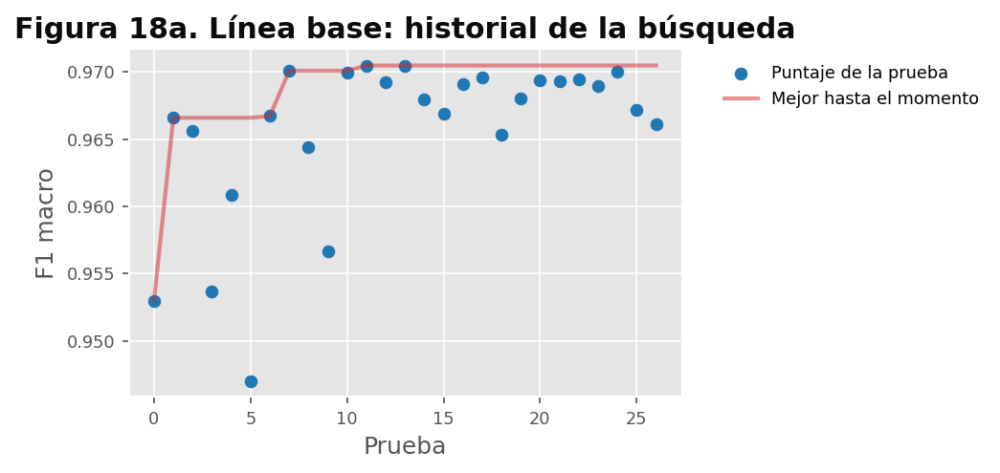

*Figura 18a. F1 macro de cada prueba.*

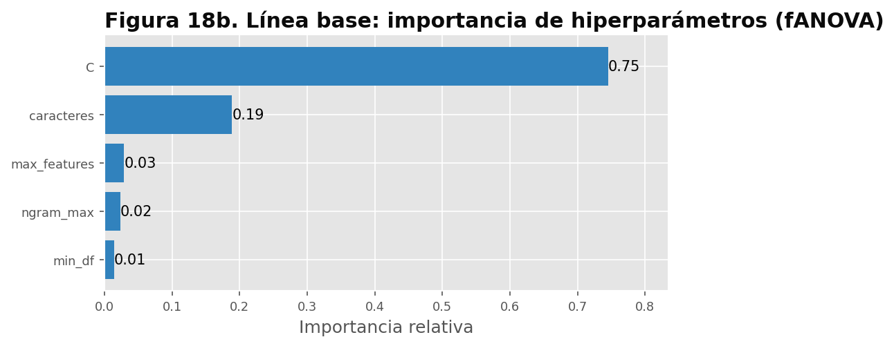

*Figura 18b. Importancia de hiperparámetros (fANOVA).*

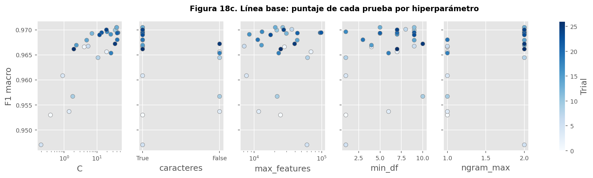

*Figura 18c. Puntaje de cada prueba por hiperparámetro.*

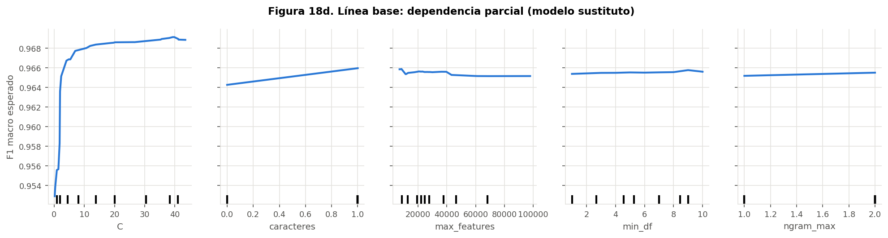

*Figura 18d. Dependencia parcial del F1 macro esperado.*

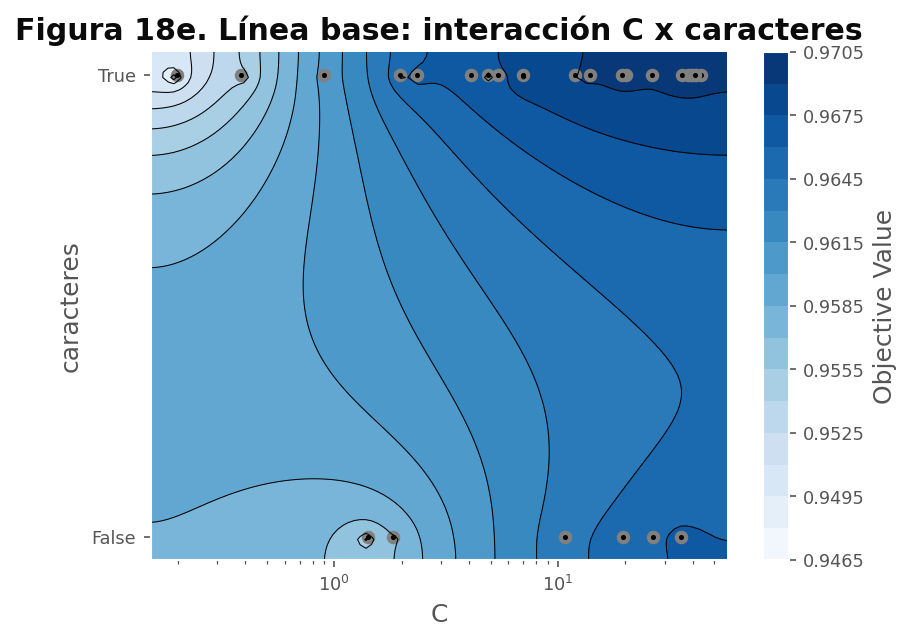

*Figura 18e. Contorno de `C` y `caracteres`.*

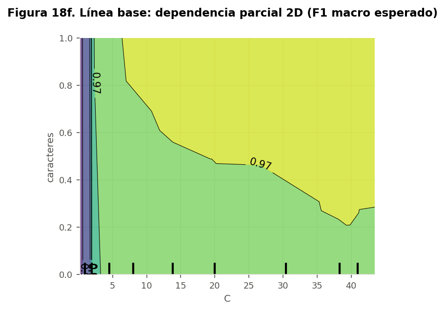

*Figura 18f. Dependencia parcial conjunta de `C` y `caracteres`.*

La búsqueda completó 27 de las 30 pruebas antes del límite de tiempo. El F1 macro va de 0,947 a 0,970.

| Puesto | Hiperparámetro | Importancia | Efecto observado |
|---:|---|---:|---|
| 1 | `C` | 0,75 | Con C menor que 3 el F1 cae de forma marcada; por encima de 10 se estabiliza |
| 2 | `caracteres` | 0,19 | Agregar n-gramas de caracteres suma unas dos milésimas |
| 3 | `max_features` | 0,03 | Sin efecto práctico |
| 4 | `ngram_max` | 0,02 | Sin efecto práctico |
| 5 | `min_df` | 0,01 | Sin efecto práctico |

**Interacción.** La dependencia parcial conjunta muestra una interacción leve: la ventaja de los
n-gramas de caracteres aparece cuando C supera aproximadamente 3 a 5; con C bajo, ambas opciones
rinden mal. El valor actual (C = 8, con caracteres) está en la meseta.

### 3.3 Antes y después

| | Configuración actual | Mejor de la búsqueda |
|---|---|---|
| Hiperparámetros | C 8; 100.000 términos; 1-2 gramas; `min_df` 3; con caracteres | C 39,8; 20.518 términos; 1-2 gramas; `min_df` 5; con caracteres |
| F1 macro medio en 6 pliegues pareados | 0,9689 (desviación 0,0027) | 0,9697 (desviación 0,0035) |
| Mejora media e IC 95 % | | 0,0009 [-0,0005; 0,0023] |
| Wilcoxon | | p = 0,56 |

El intervalo incluye el cero: **se mantiene la configuración actual**.

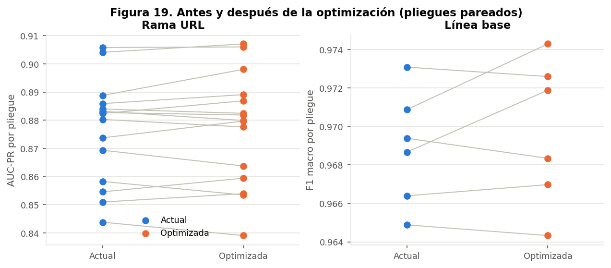

*Figura 19. Puntaje por pliegue de la configuración actual y de la optimizada. Cada línea une el
mismo pliegue evaluado con ambas configuraciones; las líneas se cruzan en ambos sentidos.*

## 4. Configuración final y justificación

La configuración final es la publicada en la versión `v2` del modelo y registrada en `config.yaml`.

1. **Qué importa.** En la rama URL, solo `min_child_weight`; en la línea base, la regularización (C)
   y, en menor medida, los n-gramas de caracteres. El resto se puede fijar sin pérdida y no merece
   presupuesto en una búsqueda futura.
2. **Interacciones.** Ninguna relevante en la rama URL; una leve en la línea base.
3. **Rangos.** Ambas configuraciones actuales están en la zona plana de la respuesta. Para una búsqueda
   futura conviene ampliar C hacia arriba y fijar los demás hiperparámetros de la línea base.
4. **Por qué no se cambia.** Las mejoras encontradas (0,0007 y 0,0009) son menores que la variación
   entre pliegues y sus intervalos incluyen el cero. La prueba final de la rama URL confirma que la
   ventaja era ruido.

## 5. Optimizaciones que sí produjeron mejoras medibles

La búsqueda de hiperparámetros no mejoró el modelo de forma significativa. Las mejoras cuantificables
del proyecto vinieron de decisiones de diseño, evaluadas con el mismo rigor:

| Decisión | Antes | Después | Fuente |
|---|---|---|---|
| Fusión de las tres ramas (V3) frente a la línea base sola (V0) | Recall de phishing no visto: 87,3 % de promedio en 4 pliegues | 93,4 % | `results/metrics/fusion_v1.json` |
| Fusión frente a la línea base en un corpus nunca visto (phishing_pot) | 68,5 % | 83,5 % | `results/metrics/fusion_v1.json` |
| Calibración isotónica del meta-clasificador | Brier de DistilBERT 0,0153 | Brier de la fusión 0,0111 (27 % menor) | `results/metrics/evaluacion_final.json` |
| Umbral operativo en lugar del de validación | FPR en correo corporativo 12,5 % (IC 10,6 a 14,7) | 1,3 % (IC 0,8 a 2,2), con recall de 95,97 % | `results/metrics/fpr_enron_v1.json` |
| Política de umbral por FPR (D9) en lugar de recall fijo | Recall en phishing no visto con el modelo de texto: 50,9 % | 87 % con cualquier variante | Bitácora, sección 5 |

## 6. Robustez ante escenarios críticos (Workshop 1)

**Pregunta guía.** ¿Hasta qué nivel de perturbación sigue siendo útil el detector?

Sobre una muestra estratificada de 2.000 correos de prueba se aplicó cada perturbación al texto, se
recalcularon las tres ramas y la fusión con el umbral operativo y se comparó con la misma muestra sin
perturbar. **Criterio fijado de antemano:** el escenario pasa si el recall de phishing cae como máximo
5 puntos y el FPR no supera el 2 %.

| Escenario | Nivel | Recall | FPR | Caída de recall | Resultado |
|---|---|---:|---:|---:|---|
| Referencia | Sin perturbar | 95,9 % | 0,24 % | | |
| A. Ruido tipográfico | 2 % de las letras | 95,3 % | 0,26 % | 0,5 | Pasa |
| A. Ruido tipográfico | 10 % de las letras | 93,7 % | 0,31 % | 2,2 | Pasa |
| B. Ofuscación de palabras sensibles | p@55w0rd y similares | 95,0 % | 0,24 % | 0,8 | Pasa |
| C. Texto truncado | 1.000 caracteres | 96,1 % | 0,24 % | -0,3 | Pasa |
| C. Texto truncado | 300 caracteres | 90,1 % | 0,24 % | 5,8 | **Falla** |
| D. Rama URL caída | Bloque URL neutro | 90,9 % | 0,18 % | 5,0 | Pasa en el límite |
| E. Sin enlaces | Sin URL en texto ni en la rama | 92,0 % | 0,18 % | 3,9 | Pasa |
| F. Desbalance | 1 % de phishing | 96,4 % | 0,19 % | -0,5 | Pasa; la precisión baja a 83,7 % |
| G. Corpus no visto | phishing_pot fuera | 83,5 % | 0,95 % | 12,3 | **Falla** |
| G. Correo corporativo | Enron | 96,0 % | 1,3 % | -0,1 | Pasa |
| G. Español nativo | SpaPhish y SpearPhishMX | 93,5 % | 3,5 % | 2,3 | **Falla** por FPR |

Las filas G no son perturbaciones de la muestra sino mediciones ya hechas: el corpus no visto proviene
del pliegue fuera de distribución (con el umbral de validación de ese pliegue), y las filas de correo
corporativo y español reportan el recall en la prueba correspondiente con el FPR medido en esos correos.

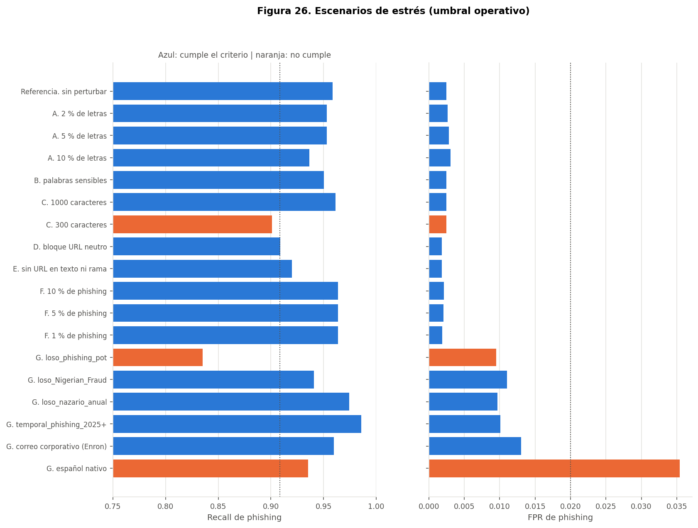

*Figura 26. Recall y FPR de phishing por escenario, con los límites de aceptación.*

**Lectura.** El detector tolera el ruido tipográfico y la ofuscación de palabras clave (no depende de
palabras exactas). Lo que más lo degrada es un corpus de phishing nunca visto y los textos muy cortos.
Quitar la rama URL resta 5 puntos de recall, que es su aporte con el umbral operativo. Con 1 % de
phishing la exactitud sube a 99,5 % mientras la precisión baja a 83,7 %, lo que muestra por qué el
proyecto reporta recall, precisión y FPR en lugar de exactitud. Las mitigaciones de los escenarios que
fallan (aviso de texto corto en la interfaz, reentrenamiento periódico y revisión manual en español)
están en [consideraciones_eticas.md](consideraciones_eticas.md).

## Referencias

* Akiba, T., Sano, S., Yanase, T., Ohta, T. y Koyama, M. (2019). Optuna: A next-generation
  hyperparameter optimization framework. arXiv:1907.10902. https://arxiv.org/abs/1907.10902
* Hutter, F., Hoos, H. y Leyton-Brown, K. (2014). An efficient approach for assessing hyperparameter
  importance. *Proceedings of the 31st International Conference on Machine Learning*, PMLR 32(1),
  754-762.
